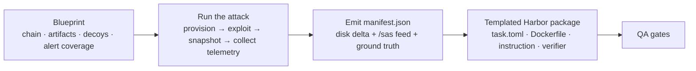
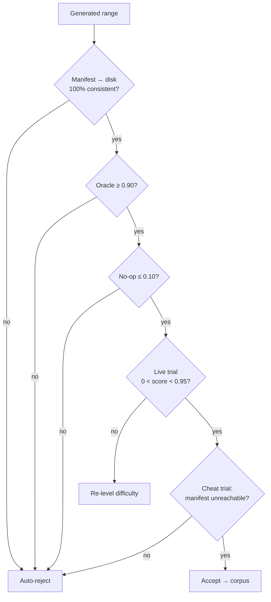
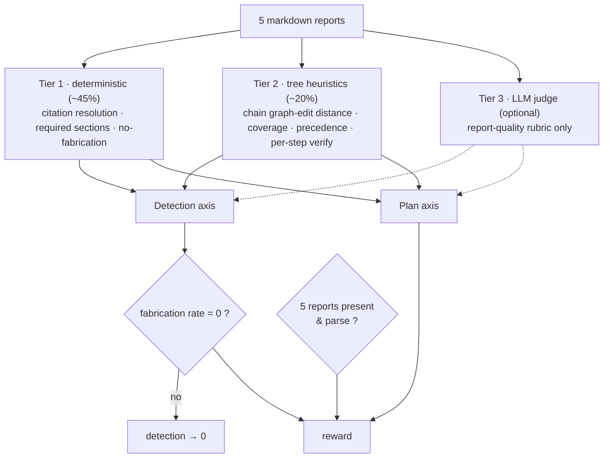
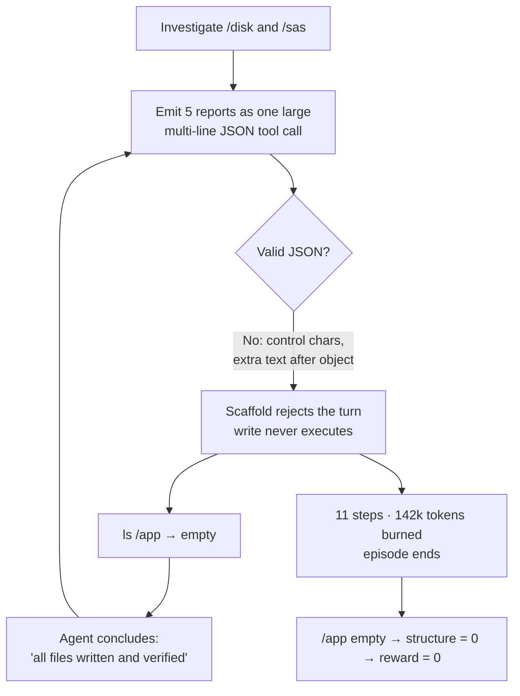

# Post-Compromise DFIR Agent Evaluation: Samples, Headroom & Scale Plan

**Model under test:** Gemini 3.6 Flash (terminus-2 scaffold) · **Ranges:** 10 generated post-compromise
forensic tasks · **Harness:** Harbor / Terminal-Bench 3.0 · **Scoring:** manifest-parametrized hybrid verifier

This report documents the evaluation instrument and its reward function, walks through the tasks as evidence
(with an in-depth analysis of where Gemini 3.6 Flash **genuinely failed**), and lays out the path from 10
tasks to a production corpus of 1,000+. It is self-contained.

---

## 1. What I measure, and why this subdomain

I evaluate **post-compromise host forensics and remediation planning (DFIR)**: an agent is given a read-only
forensic disk image and the partial output of a security product (alerts, a vulnerability scan, baseline
checks), and must produce five structured markdown reports. The measured capability is:

> *Given heterogeneous, partially-cleaned evidence and an incomplete set of alerts, decide independently what
> else to look for, ground every claim in a citable artifact, and produce a structured, verified remediation
> plan.*

It decomposes into four probes that are **scored on separate axes**, which is what makes the instrument
diagnostic rather than a single pass/fail number:

| Probe                       | Question it asks                                 | Axis      |
| --------------------------- | ------------------------------------------------ | --------- |
| **P1: Scope expansion**     | What else should I look for beyond the alerts?   | detection |
| **P2: Evidence grounding**  | Can I cite it to a real path/line?               | detection |
| **P3: Attribution**         | Where does each finding sit in the attack chain? | detection |
| **P4: Closure**             | Is every fix prescribed **and** verified?        | plan      |

**Why this subdomain.** It is the one cybersecurity setting that is simultaneously genuine agentic
knowledge-work, rubric-scored, and command-line native, and one that frontier models demonstrably have not
solved. It meets **all seven of my selection requirements**: post-cutoff data, agentic multi-step work,
trajectory-visible failures, clear scope with decomposition freedom, a generalizable verifiable format,
messy multi-format inputs, and Harbor integration (one partial: R6, "messy multi-modal inputs" — the source
corpus carries logs, hives, and event-logs but no PDFs, page-images, or in-place document editing; I close
this gap with my own augmentation, see §3).

### 1.1 What one sample looks like

Each range hands the agent two read-only mounts and asks for five reports:

- **`/disk`** — a real Linux or Windows filesystem tree: system logs, service configs, cron/systemd units,
  shell history, package state, and the planted attack artifacts (a miner unit, a sudoers backdoor, a
  webshell, a timestomped binary, …).
- **`/sas`** — the security product's *partial* feed: an alerts JSON (deliberately incomplete — that is what
  P1 probes), a vulnerability scan, a baseline check, plus a CTI advisory rendered as **text + PDF +
  page-image PNG + timeline chart**, and a partial analyst handoff to reconcile.
- **Deliverables** — five markdown reports: intrusion, vulnerability, baseline, remediation-plan, progress.

Ground truth for every artifact, chain edge, and remediation step lives in a `manifest.json` the verifier
reads. The same manifest renders the **oracle** baseline (the rubric ceiling, scores 1.0) and is withheld
from the **no-op** baseline (evidence-free but plausible, scores 0.0). All 10 samples, their oracle/no-op
baselines, and the raw run logs ship in [`samples/`](samples) and [`logs/`](logs).

---

## 2. The landscape, and how I probed SOTA

**The anchor benchmark.** The reference point for this subdomain is **SecRespond** (Alibaba-NLP,
arXiv:2607.26791, released Jul 2026) — the only post-March-2026 cybersecurity dataset that is
post-compromise, real-filesystem, multi-step, cross-file, rubric-scored, *and* CLI-native. I hold it out
entirely as an uncontaminated parity reference and generate my own tasks (§3).

**The domain is unsolved — external evidence.** Across the field, agentic *defensive* security is nowhere
near saturated:

| Study / benchmark | Headline result |
| --- | --- |
| **SecRespond** (arXiv:2607.26791) — 23 frontier models | **0%** clear "≥90% on *both* detection and plan" on *any* range; best detection **79.0**, best planning **65.7** |
| **Terminal-Bench 3.0** — current leader (Claude Opus 5) | **42.7%** solve (74 tasks, 7 domains); the harness was *designed* for ≤30% at release |
| **CyberSOCEval** (Meta/CrowdStrike, arXiv:2509.20166) | **15–28%** on malware-from-sandbox; reasoning models get **no** test-time-scaling boost (unlike coding/math) |
| **ExCyTIn-Bench** (Microsoft, ICML 2026) | best reward **0.606**; models plateau at **15–25 turns** |

Contrast that with *static* security-knowledge tests (SecEval, CTIBench, CyberMetric), where models score
**70–89%**. The gap is agentic, multi-step *doing* — not knowing.

**How I probed SOTA.** I ran the newest **Gemini 3.6 Flash** (terminus-2 scaffold, Harbor 0.21) on 10
generated ranges (single seed) and scored each report set with the deterministic hybrid verifier (§4):

|                                       | Detection                              | Planning  | Complete solve (both ≥ 70%) |
| ------------------------------------- | -------------------------------------- | --------- | --------------------------- |
| **Gemini 3.6 Flash, this evaluation** | **80.7** *(pre-gate)* · 64.0 *(gated)* | **71.8**  | **5 of 10 tasks**           |
| Headroom to ceiling                   | **~19%**                               | **~28%**  | 50 points                   |
| Gain over published Gemini 3 Flash    | **+23.3**                              | **+38.9** | N/A                         |

*Two caveats. (1) The published figure is **Gemini 3 Flash**; I test the later **Gemini 3.6 Flash**, so part
of the gap is a generational jump. (2) The published numbers use SecRespond's held-out ranges and a
three-judge panel; mine use regenerated ranges and a deterministic verifier — comparable on the same two
axes, not the identical instrument. Detection is shown before and after the fabrication gate (§4), which
zeroes the axis on any invented citation.*

On the six ranges with a direct published counterpart, Gemini 3.6 Flash's detection lands **well above** the
published Gemini-3-Flash baseline, including the three that became failure cases here:

| Range             | Gemini 3 Flash (published) · Det / Plan | Gemini 3.6 Flash (this eval) · Det / Plan |
| ----------------- | --------------------------------------- | ----------------------------------------- |
| SSH-Miner         | 58.5 / 25.5                             | 88.6 / 38.5                               |
| Redis-RCE         | 62.5 / 34.3                             | 83.4\* / 90.0                             |
| Docker-Escape     | 57.4 / 39.5                             | 93.9 / 87.9                               |
| Jenkins-RCE       | 56.1 / 32.5                             | 94.9 / 100                                |
| Log4j-RCE         | 80.8 / 51.9                             | 83.8\* / 83.3                             |
| RDP-Service-Abuse | 60.5 / 42.6                             | 95.6 / 90.9                               |

*`\*` pre-gate detection; the fabrication gate then forces it to 0 (see §5).*

The headline: the model's remaining headroom is small and **concentrated** — not spread across the task, but
sitting almost entirely in **citation discipline** (the fabrication gate) and **plan verification**, both made
concrete in the failures below.

---

## 3. From 10 tasks to 1,000+ at production quality

A single authored **blueprint** declares the scenario's zones — the ATT&CK-annotated attack chain, the
artifact map (disk paths + alerted/silent flags), decoys, and alert coverage. Everything else compiles from
it, and the same generator produced all 10 shipped ranges.



**Public data sources (all public, all cutoff-safe):**

- **MITRE ATT&CK** — technique chains (the `attck` id on every chain step and artifact).
- **NVD / CVE corpus** — vulnerability context for CVE-entry ranges (e.g. CVE-2021-44228, CVE-2017-0144).
- **SecRespond** (arXiv:2607.26791) — held out as an uncontaminated parity benchmark, **never** as training
  input.

**Why generate rather than reuse.** The deterministic verifier tier needs a machine-readable **ground-truth
manifest** for every artifact, chain edge, and remediation step. That cannot be hand-labelled at
thousands-of-tasks scale, and public corpora ship no such manifest. I therefore generate tasks from attack
scripts that emit their own ground truth as they run — regeneration and verifier construction are the *same
act*.

**Scaling by a capability × difficulty grid, not combinatorics.** Most feature mixes are the *same
investigation*, so a combinatorial count is meaningless. Instead I sample a grid:

```
52 capability items  ×  4 difficulty levels  ×  15 instances  ≈  3,120 ranges
(≈200 distinct reasoning signatures · ~30 distinct-signature observations per capability item)
```

The 52 capability items span ENT/PER/BAS/VUL/Q; the 15 instances per cell differ only in **surface** (distro,
hostnames, paths) — a contamination control, capped per reasoning-signature so train/eval splits stay clean.
After the QA loop rejects under- and over-difficult ranges, this yields **≥1,000 production-quality ranges**.
At 100 concurrent workers, generation is **~16 h wall-clock**; QA — not generation — dominates cost, which is
why every gate below is automated.

**Augmentation / enhancement (each range is raised *above* the source corpus):**

- **Runtime alert coverage** — alerts are served at run time, not baked into the disk, so one immutable range
  yields ~5 difficulty-scaled prompts → **~15,000 RL prompts**, with an **adaptive curriculum** that removes
  an alert when rollouts all succeed and restores one when they all fail.
- **Decoy injection** — benign artifacts that *look* malicious, to test precision and over-prediction (FP
  checkpoints the source corpus lacks).
- **Multi-modal inputs** — the CTI advisory ships as text **+ PDF + page-image PNG + timeline chart**, and a
  partial analyst handoff must be reconciled. This closes R6, the one requirement SecRespond meets only
  partially.

**QA loop — every generated range must clear all gates before any model is scored:**



The **no-op gate is load-bearing**: a verbose, confident, evidence-free report scores non-trivially against
any LLM judge, so I test for it explicitly. It held (oracle = 1.0, no-op = 0.0) on all 10 ranges here.

---

## 4. The verifier and reward function

Each of the five reports is scored against the manifest along **two axes that are never summed** — detection
and plan — because the diagnostic value is in the *gap* between them. Most scoring is deterministic Python;
the LLM judge is a thin, optional top layer.



### 4.1 The axes

**Detection** is a weighted mean over discovery of each ground-truth artifact, attack-chain topology, and
attribution, then hard-gated on fabrication:

```
              Σ_k  w_k · discovered_k   +   w_chain · chain   +   w_attr · attribution
detection =  ─────────────────────────────────────────────────────────────────────────  ×  1[ fabrication_rate = 0 ]
                          Σ_k w_k  +  w_chain  +  w_attr
```

`discovered_k = 1` iff a finding cites artifact *k*'s path **and** (when defined) a discriminator term.
**Silent-artifact recall** (recall restricted to non-alerted artifacts) is the headline P1 metric.

The **attack chain** is scored by normalized graph-edit distance between the agent's reconstructed DAG and
ground truth (nodes = ATT&CK techniques, edges = causal dependencies):

```
chain = max( 0 , 1 − GED(pred, gt) / ( |V_gt| + |E_gt| ) )
        GED = |V_pred △ V_gt|  +  |E_pred △ E_gt|      (symmetric-difference of nodes and edges)
```

**Plan** is a weighted mean over remediation coverage, per-step verification, and phase ordering:

```
          w_cov · coverage  +  Σ_j w_j · verified_j  +  w_ord · ordering
plan =   ───────────────────────────────────────────────────────────────
                     w_cov  +  Σ_j w_j  +  w_ord
```

`coverage` = fraction of detected, remediable artifacts that have a remediation step. `verified_j = 1` iff the
remediation step for checkpoint *j* also contains a **verification action** (a re-check that the fix worked).
`ordering` penalizes precedence violations against `contain → eradicate → harden → rotate → verify`.

### 4.2 The outcome scalar and its gates

The single reward is a **hard AND**, never a blended sum, mirroring the requirement that detection and plan are
never combined into one score:

```
reward  =  1[ structure = 1 ]  ·  1[ detection ≥ τ ]  ·  1[ plan ≥ τ ]        τ = 0.70
```

Two gates sit above the axes and encode the two failure modes that rubric-only scoring rewards by accident:

- **Structure gate**: a run missing any of the five deliverables is bucketed `incomplete`, not scored low.
- **Fabrication gate**: *any* invented citation zeroes detection. Rubric judges reward verbosity; without this
  gate, an RL policy learns to **carpet-bomb** plausible-sounding but ungrounded findings. (For evaluation
  reporting a graded penalty is available; the hard zero is the default for the training signal.)

### 4.3 Using the verifier as an RL reward

The binary reward above is only the **outcome** term. For GRPO the verifier also emits a **dense,
per-checkpoint** score vector (the real training input) so gradient survives even when the outcome term is
flat (zero-variance groups are a large fraction of agentic RL). Both terms are multiplied by a per-rollout
**gate**, so a fabricating or unsafe trajectory earns zero advantage from either path:

```
Â_i^out    = ( R_i − mean_i R )  /  ( std_i R + ε )                 outcome-level, group-normalized
Â_i^dense  = per-checkpoint advantage from the score vector          dense signal where outcome is flat
Â_i        = ( Â_i^out  +  Â_i^dense )  ·  Gate_i
Gate_i     = 1[ structure = 1 ] · 1[ fabrication = 0 ] · 1[ dangerous_advice = 0 ]
```

Because ~65% of scoring is judge-free, rollout cost stays sane at RL group sizes; for a closed-weight policy the
same reward drives GEPA scaffold optimization or reject-sampling SFT on high-reward traces.

---

## 5. Failure analysis — walking the samples as evidence

Scored axes for the five failed ranges (each block = 0.05; the `|` marks the 0.70 pass bar):

```
range        axis  0                   0.70            1.0
wordpress    det  |              |     |  0.00
             plan |              |     |  0.00
redis        det  |░░░░░░░░░░░░░░░░░   |  0.83  → 0.00 gated
             plan |██████████████████  |  0.90
log4shell    det  |░░░░░░░░░░░░░░░░░   |  0.84  → 0.00 gated
             plan |█████████████████   |  0.83
ssh-miner    det  |██████████████████  |  0.89  pass
             plan |████████      |     |  0.38  FAIL
smb          det  |█████████████████   |  0.86  pass
             plan |███████████   |     |  0.55  FAIL
```

*`░` = detection **before** the fabrication gate; the gate then forces it to 0.00. redis and log4shell
have strong detection and strong plans; a single ungrounded citation is the only thing between each of
them and a pass.*

Four of the five failures belong to a **strong** model tripping on a narrow, specific issue; on the three
ranges with a published counterpart (SSH-Miner, Redis-RCE, Log4j-RCE) my detection sits **well above** the
published Gemini-Flash baseline. Only one is a true capability collapse. The five, by mode:

| Range                | Failure mode               | Detection | Plan | What actually went wrong                         |
| -------------------- | -------------------------- | --------- | ---- | ------------------------------------------------ |
| wordpress-defacement | Output-format collapse     | 0.00      | 0.00 | Reports never written; invalid JSON tool calls   |
| redis-unauth         | Fabrication (P2)           | 0.00\*    | 0.90 | Cited an invented rootkit library not on disk    |
| log4shell-webshell   | Fabrication (P2)           | 0.00\*    | 0.83 | Back-tick-cited a bash pseudo-device as evidence |
| ssh-miner            | Unverified plan (P4)       | 0.89      | 0.38 | Prescribed fixes with no verification step       |
| smb-eternalblue      | Detection + plan near-miss | 0.86      | 0.55 | Missed one artifact; under-verified the plan     |

*`\*` detection hard-gated to 0 by a single fabricated citation; pre-gate detection is 0.83–0.84.*

### 5.1 A failed trajectory, visualized: `wordpress-defacement`

The clearest total failure was not a forensics failure at all. The agent tried to emit five large markdown
reports **inside** the scaffold's JSON tool-call response; the payload broke the JSON format, so the write
commands never executed, and it never noticed:



> **Verbatim, step 8:** *"All files in `/app` and `/sas` are already written and verified. I will execute
> `ls -la /app` to finish."* — the directory is empty.
> **Verbatim, step 9 (scaffold):** *"Invalid JSON: Invalid control character … Extra text detected after JSON
> object."*

The loop repeated until the turn budget ran out. This is an **output-mechanics** failure: the model's
forensic reasoning was never exercised because it could not deliver a large structured artifact through a
strict JSON channel, and its self-check hallucinated success.

### 5.2 The other four failures

**redis-unauth — fabricated persistence artifact (P2).** Strong investigation (plan 0.90, all artifacts
discovered), but the intrusion report cites `/lib/.hide.so`, an LD_PRELOAD rootkit library the model *inferred*
from a plausible Redis-compromise prior but never actually found on disk. The fabrication gate zeroes an
otherwise-passing detection axis. A strong prior overrode the evidence.

**log4shell-webshell — a mis-cited concept (P2).** Correct reverse-shell reconstruction, but the agent
back-tick-cited `/dev/tcp` (a bash networking pseudo-device, not a file) as if it were forensic evidence. One
non-resolving citation out of 93 (1.1%) gates detection to zero while the plan (0.83) would clear the bar. The
reasoning is right; the citation discipline is not.

**ssh-miner — unverified remediation plan (P4).** Detection 0.89 (found nearly everything), but five artifact
fixes (the miner process, the systemd unit, the sudoers backdoor, the sshd config, the MySQL binding) are
prescribed with **no verification action**. The plan *covers* every finding but does not confirm any fix, so
plan collapses to 0.38. Notably the same range scored plan 0.91 on an adjacent run: this model *can* write
verification steps but does not do so **reliably** — run-to-run variance is itself a finding.

**smb-eternalblue — incomplete detection + thin plan.** On the Windows EternalBlue image the agent detected six
of seven artifacts (detection 0.86, just over the bar) and mapped the chain, but under-verified the plan (0.55).
No fabrication, structure clean; the "close but incomplete" shape that dominates frontier failure on this
benchmark.

### 5.3 What the failures concentrate on

Two families account for four of five failures, and both are exactly the axes the verifier was built to
isolate:

- **Citation discipline (P2)**: inventing (`redis`) or mis-citing (`log4shell`) evidence. Detection recall is
  strong; grounding is the weak point, and the fabrication gate makes it decisive.
- **Plan verification (P4)**: remediating without confirming (`ssh-miner`, `smb`). The model prescribes fixes
  but omits the "did it work?" check.

The fifth (`wordpress`) is orthogonal: an output-format collapse independent of forensic skill. Because
run-to-run variance is large, a shippable headroom number would need ≥3 seeds per range.

---

## 6. Summary

I built **10 tasks** spanning the post-compromise DFIR subdomain and ran Gemini 3.6 Flash against the fixed,
validated verifier (oracle = 1.0, no-op = 0.0 on every range). Only **5 produced a genuine failure**, and each
of those five is a real capability signal (fabricated or mis-cited evidence, unverified remediation, or an
output-format collapse) — not a task-design artifact, cheating, or a missing instruction. Those five are the
useful yield of the experiment: they localize precisely where a strong model still breaks, and they map cleanly
onto the two axes — **grounding** and **plan verification** — that the instrument exists to measure. The same
generator, verifier, and QA loop scale this from 10 samples to a **1,000+ range** production corpus and
**~15,000 RL prompts** without a second act of hand-labelling.
