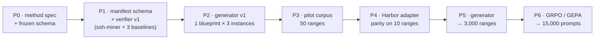

# Post-Compromise DFIR Agent Evaluation Programme

Working documents for building Harbor tasks, a hybrid verifier, and a scalable corpus in
the cybersecurity subdomain of **post-compromise host forensics and remediation planning**.

| Doc | Contents | Use it to |
|---|---|---|
| [01 — Dataset Selection & Landscape](01-dataset-selection-and-landscape.md) | Screening of 15 candidate datasets, target-capability decomposition (P1–P4), external benchmark results, SOTA probing protocol, metrics, validity controls | Justify the choice; calibrate expectations; pre-register hypotheses |
| [02 — Verifier Design & GRPO Reward](02-verifier-design-and-grpo-reward.md) | Verifiability spectrum, three-tier hybrid verifier, Reward Kit implementation, failure taxonomy, per-checkpoint GRPO advantage, gates and shaping | Build the verifier; define the reward |
| [03 — Scalability & Regeneration](03-task-scalability-and-regeneration.md) | Why we regenerate, why naive combinatorics fails, 52×4×15 sampling grid, generator architecture, manifest schema, QA gates, curriculum | Get from 10 ranges to ~3,000 ranges / ~15,000 prompts |
| [04 — Task Implementation: `ssh-miner`](04-task-implementation-ssh-miner.md) | Full worked example: scenario, checkpoint map, `task.toml`, Dockerfile, manifest, criteria, and no-op / oracle / alert-transcriber baselines | Build task #1 end to end |

## The one-paragraph version

Post-compromise DFIR is the only cybersecurity subdomain with a post-March-2026 corpus that
is simultaneously agentic knowledge work, rubric-scored, and CLI-compatible. **SecRespond**
(10 ranges, 280 checkpoints, 23 frontier models, **0 complete solves**) is the anchor. The
measured capability is *proactive, evidence-grounded investigation and verified remediation*
— and frontier models fail it in one reproducible way: they follow the alert trail and stop.
SecRespond serves as a **held-out evaluation set only** — it ships no machine-readable
manifest (so it cannot drive the deterministic verifier tier), and keeping it out of
training preserves it as an uncontaminated benchmark. Training data comes from our own
generator, whose attack scripts emit a manifest that doubles as deterministic verifier
ground truth.

## Critical path

Phase IDs match the roadmap in `03-task-scalability-and-regeneration.md` §7.

## Non-negotiables

1. **No-op ≤ 0.10 and oracle ≥ 0.90** before any model is scored. A verbose, confident,
   evidence-free report scores non-trivially against any LLM judge; if you don't test for
   it, you will measure prose style.
2. **Detection and plan are never summed in any reported metric.** Explicit dataset-card
   requirement, and the diagnostic value is in the gap. The RL training loop still needs a
   single scalar per rollout (doc 02 §4.3 blends the two axes for that purpose only); that
   blended scalar is never surfaced as a score.
3. **Refusals are a separate outcome bucket**, not reward 0.
4. **Signature count ≠ range count.** Report both, or the corpus-size claim is dishonest.
5. **SecRespond never enters the training loop.**

## Open items

- [ ] Confirm whether a GRPO/RL tuning path exists for the intended closed-weight policy; if not, fall back to open-weight + SkyRL or GEPA prompt/scaffold optimization
- [ ] Decide whether Q-dimension items enter the reward or stay eval-only
- [ ] Pin `checklist.md` (authoritative, Chinese) vs. `checklist.en.md` and diff them
- [ ] Choose the chain metric: graph-edit distance vs. path coverage

---

*All external figures are cited inline in the relevant document. Placeholders marked
`_[TBD]_` are reserved for our own run data — fill them from `runs/<date>-<model>-<scaffold>/`
and keep trial IDs so every claim stays traceable.*
