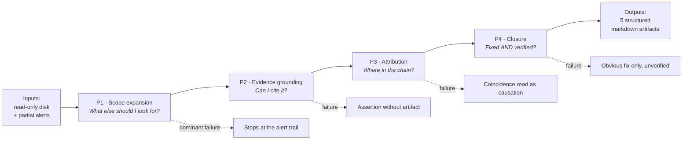
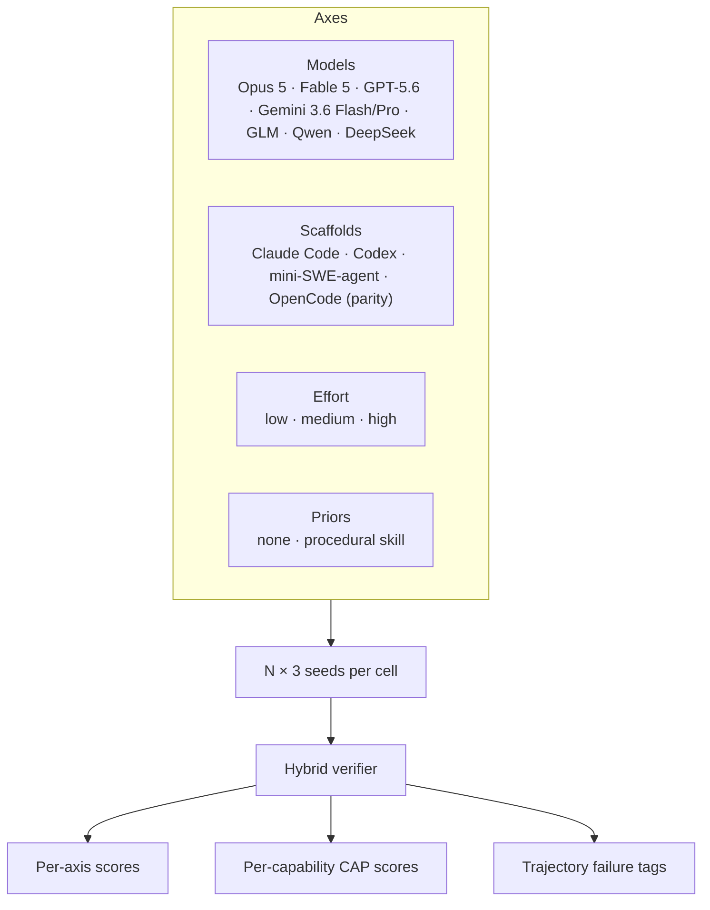

# 01 — Dataset Selection, Target Capabilities, and the SOTA Landscape

**Domain:** Cybersecurity → Post-compromise host forensics & remediation planning (DFIR knowledge work)
**Anchor dataset:** SecRespond (Alibaba-NLP, arXiv:2607.26791, released 29 July 2026)
**Harness:** Harbor (Terminal-Bench 2.0/3.0 official harness)
**Status:** Selection locked · verifier and generator in design
**Owner:** _[your name]_ · **Last updated:** _[date]_

---

## 1. Executive summary

We select **post-compromise incident response** as the cybersecurity subdomain and
**SecRespond** as the anchor corpus.

The one-line rationale: this is the only cybersecurity dataset released after March 2026
that is simultaneously (a) genuine agentic knowledge work with a structured artifact
deliverable, (b) multi-step with real decomposition freedom, (c) demonstrably unsolved by
frontier models, and (d) CLI-compatible and therefore adaptable to Harbor.

The capability being measured is narrow and legible:

> Given heterogeneous, partially-cleaned forensic evidence and an incomplete set of
> alerts, decide independently what else to look for, ground every claim in a citable
> artifact, and produce a structured, verified remediation plan.

Frontier models fail this in a specific, reproducible way: they follow the alert trail and
stop. That is a *reasoning* failure, not a tooling or verifier-design failure, which is
exactly what we need.

**Important scoping note.** SecRespond is used in this programme as a **held-out
evaluation set and parity baseline only**, for two engineering reasons: it ships no
machine-readable manifest (so it cannot drive the deterministic verifier tier, doc 02),
and holding it out of training keeps it an uncontaminated benchmark. All training-loop
data comes from our own generator (see `03-task-scalability-and-regeneration.md`). This
document explains why SecRespond is the right *target* to calibrate against, not the right
thing to train on.

---

## 2. Selection: how we got here

### 2.1 Requirements

| # | Requirement |
|---|---|
| R1 | Underlying data released **strictly after March 2026** (March or earlier fails; for revised papers the data-collection date governs, not the resubmission date) |
| R2 | Agentic knowledge work (not MCQ, not pure exploitation) |
| R3 | Multi-step, reasoning-heavy, with failures visible in the trajectory — reasoning errors, tool-call failures, misread instructions, bad decomposition. **Not** task-design artifacts (cheating, missing instructions, broken verifiers) |
| R4 | Clear instructions and scope, with real room for decomposition decisions |
| R5 | Standard, verifiable task format generalizable across the whole subdomain |
| R6 | Messy inputs (tables, screenshots, PDFs, charts, corrupted data); structured-schema outputs; in-place artifact editing; reasoning interleaved with citations |
| R7 | Easily integrable with Harbor or a built-in Harbor dataset |

### 2.2 Screening results

| Dataset | Released | R1 | R2 | R3 | R4 | R5 | R6 | R7 |
|---|---|:--:|:--:|:--:|:--:|:--:|:--:|:--:|
| **SecRespond** | Jul 29 '26 | ✅ | ✅ | ✅ | ✅ | ✅ | ⚠️ | ✅ |
| CTI-REALM | Mar 17 '26 | ❌ | ✅ | ✅ | ✅ | ✅ | ❌ | ❌ |
| CritBench (OT/ICS) | Apr 7 '26 | ✅ | ⚠️ | ✅ | ⚠️ | ⚠️ | ❌ | ❌ |
| CrackMeBench | May '26 | ✅ | ❌ | ✅ | ✅ | ✅ | ❌ | ✅ |
| CREBench | Apr '26 | ✅ | ❌ | ✅ | ⚠️ | ✅ | ❌ | ✅ |
| REBench | Apr '26 | ✅ | ❌ | ❌ | ❌ | ✅ | ❌ | — |
| REFORGE | Jul '26 | ✅ | ❌ | — | — | — | — | — |
| ReCon (ISO 27002 GRC) | Jul 24 '26 | ✅ | ❌ | ⚠️ | ❌ | ✅ | ❌ | ❌ |
| CyberCertBench | Apr '26 | ✅ | ❌ | ❌ | ❌ | ✅ | ❌ | — |
| ExCyTIn-Bench | v3 May '26 (data Jul '25) | ❌ | ✅ | ✅ | ⚠️ | ✅ | ❌ | ✅ |
| ZeroDayBench | Mar 2 '26 | ❌ | ⚠️ | ✅ | ✅ | ✅ | ❌ | ✅ |
| OrgForge-IT | Mar 23 '26 | ❌ | ✅ | ✅ | ⚠️ | ✅ | ❌ | ⚠️ |
| SuperIntel dual-mode | May '26 | ✅ | ⚠️ | ✅ | ✅ | ✅ | ❌ | ❌ |
| Wiz Cyber Model Arena | Feb '26 | ❌ | ❌ | ✅ | ✅ | ✅ | ⚠️ | ❌ |
| CyberSOCEval | Sep '25 | ❌ | ❌ | ❌ | ❌ | ✅ | ✅ | ⚠️ |

**Nothing scores 7/7.** SecRespond scores 6/7; the gap is R6 (no PDFs, charts, screenshots,
or in-place editing). Section 6 specifies the delta we author to close it.

### 2.3 Why the near-misses lost

- **CTI-REALM** — conceptually the closest sibling (investigate → produce artifact →
  verify, with a five-checkpoint trajectory reward already designed for RL). Loses on
  availability and portability: the paper's own limitation is that it targets Azure-native
  telemetry (MDE, Azure Monitor, Azure AD) and KQL, and results may not generalize to
  AWS/GCP or other SIEM query languages. Date also fails R1 (v2, 17 Mar 2026 — March is
  not post-March), same as ZeroDayBench and OrgForge-IT.
- **ExCyTIn-Bench** — strong agentic SOC benchmark and Harbor-friendly, but the data
  predates the cutoff (Jul 2025), the output is short-answer QA rather than a structured
  artifact, and the environment is a single MySQL instance — no multimodality, no
  decomposition freedom beyond query planning.
- **ZeroDayBench / OrgForge-IT** — March 2026, just outside the window.
- **ReCon / CyberCertBench** — GRC and certification knowledge are attractive knowledge-work
  domains, but neither is agentic: no tool use, no environment, no trajectory.
- **Wiz Cyber Model Arena** — good design, but internal/closed and offensive-lifecycle focused.

---

## 3. Target capabilities

### 3.1 The capability decomposition

The task decomposes into four probes that are **separable in scoring**, which is what makes
it a good instrument:



| Probe | Capability | Why it is hard | Maps to SecRespond axis |
|---|---|---|---|
| **P1** Scope expansion | Decide, unprompted, to sweep beyond given signals | No instruction says "also check `.bashrc`". Requires an internal model of where implants hide | Detection · discovery |
| **P2** Evidence grounding | Attach every finding to a path / log line / config value | Requires actually reading artifacts, not pattern-matching the scenario | Detection · evidence |
| **P3** Attribution | Wire each finding into the correct attack chain vs. coincidental artifact | Requires temporal + causal reasoning across services | Detection · attribution |
| **P4** Closure | Remediate everything found, verify the fix, check service health | Requires tracking own findings and reasoning about side effects | Plan · correctness + completeness |

### 3.2 Why this decomposition is the right instrument

1. **P1 is not measurable by any other public benchmark.** Every other defensive benchmark
   hands the agent the thing to reason about (an alert, a log, a report). SecRespond
   deliberately withholds much of it — roughly 45–70% of a range's checkpoints are silent,
   varying by range (ssh-miner sits near the low end, ~45%; the hardest ranges near the high
   end).
2. **P2 converts to a deterministic check.** Citation resolution is computable, which lets
   us score ~45% of the rubric with purely deterministic checks and — together with the
   Tier-2 tree heuristics — move ~65% of scoring off the LLM judge (see doc 02).
3. **P4 is the widest published gap** and the one with clearest commercial value —
   remediation planning is where SOC automation actually breaks.
4. **All four generalize** to any post-compromise range we generate, which is what makes
   R5 satisfiable and the corpus scalable.

### 3.3 Anti-capabilities (explicitly out of scope)

To keep the instrument clean, we are **not** measuring: exploit development, offensive
tooling, live-host response (the agent works on a frozen read-only snapshot), malware
reverse engineering, or human communication/stakeholder management. Any of these leaking
into a generated range is a generator bug.

---

## 4. Landscape: what the field knows today

### 4.1 The structural finding — knowledge ≠ capability

CAIBench (arXiv:2510.24317), a meta-benchmark spanning 10,000+ instances, is the cleanest
statement of the gap:

> Models score **70–89%** on security knowledge benchmarks (SecEval, CTIBench, CyberMetric),
> but this degrades to **20–40%** on multi-step attack-and-defence scenarios and **22%** on
> robotics targets. On CyberPII-Bench the best model reaches **F1 0.46**.

The authors' framing — "pre-trained knowledge of cybersecurity in LLMs does not imply attack
and defense abilities" — is the premise this whole programme rests on.

### 4.2 Benchmark coverage map

| Benchmark | Scope | Post-compromise | Real filesystem | Multi-step | Cross-file | Rubric | CLI |
|---|---|:--:|:--:|:--:|:--:|:--:|:--:|
| SecBench | Knowledge | ✗ | ✗ | ✗ | ✗ | ✗ | ✗ |
| NYU CTF Bench | CTF | ✗ | ✗ | ✓ | ✓ | ✗ | ✗ |
| CyberSecEval | Offensive | ✗ | ✗ | ✓ | ✗ | ✓ | ✗ |
| Cybench | CTF | ✗ | ✗ | ✓ | ✓ | ✗ | ✗ |
| CVE-Bench | CVE | ✗ | ✗ | ✓ | ✗ | ✗ | ✗ |
| AutoPatchBench | Patch | ✗ | ✓ | ✓ | ✓ | ✗ | ✗ |
| CyberGym | Vuln | ✗ | ✓ | ✓ | ✓ | ✗ | ✗ |
| CyberSOCEval | SOC | ✗ | ✗ | ✗ | ✗ | ✗ | ✗ |
| ExCyTIn-Bench | Threat detection | ✓ | ✗ | ✓ | ✓ | ✗ | ✗ |
| CyberModelArena | Offensive | ✗ | ✓ | ✓ | ✓ | ✗ | ✓ |
| **SecRespond** | **Forensic** | **✓** | **✓** | **✓** | **✓** | **✓** | **✓** |

*(Source: SecRespond Table 1.)* SecRespond is the only row that is post-compromise **and**
rubric-scored **and** CLI-compatible — i.e. the only one that is simultaneously knowledge
work and Harbor-adaptable.

The CLI column above reflects each benchmark's *native* delivery format as classified by
that table, which is distinct from Harbor-adaptability. ExCyTIn's native interface is a
database/query environment (hence CLI ✗ here), but it is wrappable behind a CLI, which is
why §2.2 still scores it R7 ✅. ExCyTIn loses on R1 (data predates the cutoff), not on
portability.

### 4.3 Published headroom in our exact subdomain

23 frontier LLMs on the OpenCode harness, three-judge averaged, 280 checkpoints:

| Finding | Number |
|---|---|
| Models achieving complete detection + remediation on **any** range | **0 / 23** |
| Best overall (Claude Opus 4.7) | 79.0% detect / **65.7% plan** |
| Worst (MiniMax M2.5) | 52.4 / 32.9 |
| Largest detect–plan gap (GPT-5.5) | 70.7 → 36.0 (**−34.7 pts**) |
| Narrowest gap (Claude Sonnet 4.5) | 8.5 pts |
| Detection: intrusion entity vs. persistence mechanism | 75.4% vs. **58.8%** |
| Planning: baseline risk vs. investigation & response quality | 55.3% vs. **31.8%** |
| Agentless production scanner baseline, persistence | **2.1%** |

Three interpretations that matter for task design:

1. **Planning is the bottleneck in aggregate.** Averaged across all 10 ranges, every one of
   the 23 models scored higher on detection than planning. This is a *dataset-wide* ordering,
   not a per-range guarantee: individual ranges invert it — on ssh-miner the best model's
   plan (83.3) exceeds its detection (77.8) (doc 04 §3) — so parity checks must reproduce the
   aggregate ordering, not assume detection > plan on every range. The paper attributes the
   aggregate gap to *incomplete* fixes rather than wrong ones: models correctly kill the
   process and delete the dropped file, then fail to rotate leaked credentials, block the
   outbound channel, or confirm the service still runs.
2. **The failure is reactive tunnel vision.** "Silent intrusions that leave no running
   process or network footprint are frequently overlooked, and the agent models rarely scan
   the whole host proactively. This shows that they tend to respond to the given clues
   instead of actively investigating the system."
3. **The gap is elicitable, not a hard wall.** Given procedural priors encoded as a skill,
   GPT-5.4 rose from 26% → 83% on the ssh-miner range; GPT-5.4 Pro gained 52%. But the fix
   is brittle: GLM-5.1 *degraded* 12% on shiro-fastjson because "such broad-scope ranges
   include attacker traces beyond the skill's enumerated categories, so the model stops at
   its boundary rather than continuing to explore."

### 4.4 Corroborating evidence from adjacent subdomains

| Source | Finding relevant to our design |
|---|---|
| CyberSOCEval (Meta/CrowdStrike, 2509.20166) | Malware analysis from sandbox reports: **15–28%** accuracy vs. 0.63% random. Reasoning models get **no** test-time-scaling boost, unlike coding/math. Text input beat images for every model; text+image was sometimes *worse* than text alone. |
| CTI-REALM (Microsoft, 2603.13517) | Best reward 0.637. Cloud multi-step correlation **0.282** vs. Linux 0.585. Medium reasoning effort beat high across all three GPT-5 generations (overthinking). Memory augmentation doubled MITRE mapping but left query construction unchanged. |
| ExCyTIn-Bench (Microsoft, ICML 2026) | Best reward **0.606**. SQL success rate correlates **0.86** with overall performance. Models plateau at 15–25 turns. |
| OrgForge-IT (2603.22499) | Two models with identical verdict F1 0.80 had baseline FP rates of **0.021 vs. 0.813** — 3 escalations vs. 41. "A model that achieves high verdict accuracy by reviewing every employee is not a detection system — it is a review system." |
| Frontier-readiness study (2605.23243) | 10–50% FPR in white-box detection; some models flag ~69% of all samples as vulnerable. Universal CWE confusion pairs: 327↔798, 918↔601, 863↔862. *(Vendor-authored — treat directionally.)* |
| ReCon (2607.22885) | Models mistook ISO requirement text inside the prompt for policy content and reported controls the policy never mentioned. Confidence scores were pure verdict-restatement: 30 for every non-conformity, 90–95 for every conformity. *(Small CPU models only.)* |
| CyberCertBench (2604.20389) | On ISA/IEC 62443, performance collapses — only one model passes at 80%, and a newer Claude Sonnet release scored *lower* than an older one. |

**Design consequences we take from this table:**

- Precision must be a first-class metric, not a footnote (OrgForge-IT, frontier-readiness).
- Never trust self-reported confidence as calibration (ReCon).
- Do not assume more reasoning effort helps (CTI-REALM).
- Multimodal input is a genuine, unmeasured weakness worth probing (CyberSOCEval).
- Newer ≠ better within a family; version regressions are real (CyberCertBench).

### 4.5 What the field's own critics say about these benchmarks

SentinelOne's review of ExCyTIn-Bench, CyberSOCEval, CyberSecEval 3, and CTIBench found
every one relies on LLMs somewhere in the evaluation loop, and — more damningly — that
"the fundamental unit of evaluation is still a question." None measure MTTD or MTTC.

Our response: keep the artifact (not the question) as the unit of evaluation, and move as
much scoring as possible off the judge. Doc 02 specifies how.

### 4.6 Calibration targets

| Reference | Value |
|---|---|
| Terminal-Bench 3.0 design target | ≤30% solve rate from best models at release |
| Terminal-Bench 3.0 current leader | Claude Opus 5, 42.7% (74 tasks, 7 domains) |
| SecRespond best, detection | 79.0% |
| SecRespond best, planning | 65.7% |
| SecRespond binary "≥90% both axes on a range" | **0% across all 23 models** |

A strict binary threshold is too hard and produces no signal. We adopt the paper's own
strong/weak cutoff — **70% per axis** — as the pass threshold, which places current frontier
performance in roughly the 25–40% band and matches the TB3 target.

---

## 5. How we probe SOTA

### 5.1 Experimental matrix



The scaffold axis is non-optional. Two independent findings say the harness dominates:
in the Stanford/CMU/Gray Swan live-network study, ARTEMIS placed **second of eleven** —
9 valid vulnerabilities, 82% valid-submission rate, beating 9 of 10 professional
pentesters — while off-the-shelf Codex and CyAgent scaffolds underperformed most humans,
on the same underlying models. And Wiz's Cyber Model Arena concluded that "offensive
capability is jointly determined: the same model can swing dramatically depending on the
agent scaffold."

If we report a single number per model, we are measuring our scaffold, not the model.

### 5.2 Probe design — five diagnostics

| Probe | Manipulation | Hypothesis under test |
|---|---|---|
| **A · Alert ablation** | Serve 90% / 60% / 35% / 10% of alerts, disk unchanged | Does performance track alert coverage rather than evidence availability? Isolates P1. |
| **B · Decoy injection** | Add benign artifacts that look malicious | Does precision collapse? Tests over-prediction. Yields FP checkpoints the original corpus lacks. |
| **C · Effort sweep** | low / medium / high reasoning | Replicate CTI-REALM's overthinking result in a forensic setting. |
| **D · Prior injection** | ± procedural skill | Replicate the 26→83% lift, and the GLM-style boundary-stopping regression. |
| **E · Modality swap** | CTI report as text vs. page images vs. both | Replicate CyberSOCEval's text-beats-images result on a task where the report drives investigation. |

### 5.3 Metrics reported

**Primary:** `detection` ∈ [0,1], `plan` ∈ [0,1] — reported separately, never summed. The
dataset card is explicit: *"Do not combine Detection and Plan into a single score."*

**Secondary:**
- `CAP-score` per dimension (ENT / PER / BAS / VUL / Q) — the diagnostic view
- **Silent-artifact recall** — recall restricted to non-alerted ground-truth items. *This is our headline metric*; it is the cleanest single number for P1.
- **Grounding rate** — fraction of findings with a resolvable `path:line` citation
- **Fabrication rate** — findings citing artifacts that do not exist on disk
- **False-positive rate** — benign artifacts reported as malicious (probe B only)
- **Verification rate** — remediation steps that include a check step
- `pass@1`, `pass@3` at the 70%-per-axis threshold
- Cost and wall-clock per trial

**Outcome buckets** (never conflated): `scored` · `refused` · `harness_error` · `incomplete_output`.
Refusal is not a reasoning failure — the paper had to drop one model's entire NPM-Worm
result because Claude Opus 4.7 returned a safety refusal on every attempt.

### 5.4 Validity controls

| Control | Purpose |
|---|---|
| **No-op baseline** | Empty-but-plausible reports. Must score < 0.10 or the verifier is broken. |
| **Oracle baseline** | Manifest rendered as reports. Must score > 0.90 or the rubric is unreachable. |
| **Judge-swap** | Re-score a 10% sample with a second judge family; report Spearman ρ. Target ρ ≥ 0.85 (paper achieved 0.86–0.87). |
| **Human spot-check** | 60 checkpoints × 10 trajectories against an expert. Paper baseline: r=0.96, κ=0.94, MAE 0.15. |
| **Self-preference check** | Never let a model judge its own family in the primary run. |
| **Language pin** | `checklist.md` is authoritative and Chinese; `checklist.en.md` is a translation. Pin one, and diff them before trusting results. |

---

## 6. Known gaps and the delta we author

SecRespond satisfies R6 only partially. Its evidence *is* heterogeneous and messy —
registry hives read via `strings -e l`, `.evtx` event logs, WMI CIM repository
`OBJECTS.DATA`, `NTUSER.DAT`, truncated auth logs, forged timestamps, deliberately
partially-cleaned traces — but there are no PDFs, charts, screenshots, or in-place editing.

Three extensions, each preserving the existing five-artifact schema:

| Δ | Extension | Probes | Effort |
|---|---|---|---|
| **Δ1** | **Multimodal CTI injection** — attach a vendor threat report as page images; require findings to be mapped to its ATT&CK claims | Directly tests CyberSOCEval's text-over-image bias in a setting where the report *drives* the investigation | M |
| **Δ2** | **In-place artifact editing** — supply a pre-filled change-ticket template with 3 stale/wrong entries; require correction rather than authoring from scratch | Instruction-following under existing structure; a distinct failure surface from generation | S |
| **Δ3** | **Mandatory inline citation + deterministic gate** | Converts the *evidence* sub-score from LLM judgment to computation; kills ReCon-style prompt-content hallucination | S |

Δ3 should be built first — it is small, it improves every other measurement, and it is a
precondition for the deterministic verifier tier.

---

## 7. Placeholders for our own runs

> **Fill these in after the pilot.** Keep raw trajectories under `runs/<date>-<model>-<scaffold>/`
> and reference trial IDs here so every claim is traceable.

### 7.1 Pilot configuration

| Field | Value |
|---|---|
| Date | _[TBD]_ |
| Harbor version | _[TBD]_ |
| Dataset / ranges | _[TBD]_ |
| Models × scaffolds | _[TBD]_ |
| Seeds per cell | _[TBD]_ |
| Verifier version | _[TBD]_ |
| Judge model | _[TBD]_ |
| Total cost / wall-clock | _[TBD]_ |

### 7.2 Headroom table

| Model | Scaffold | Detection | Plan | Silent-artifact recall | Grounding | Fabrication | pass@1 | pass@3 | $/trial |
|---|---|---|---|---|---|---|---|---|---|
| _[TBD]_ | | | | | | | | | |
| _[TBD]_ | | | | | | | | | |

**Comparison to published SecRespond baseline:** _[TBD — do our numbers reproduce the
aggregate detect>plan ordering (allowing per-range inversions like ssh-miner)? the ENT>PER
ordering?]_

### 7.3 Observed failure modes

> Template — one entry per distinct mode. Quote verbatim from the trajectory; do not
> paraphrase. Tag with the probe (P1–P4) and the capability item (ENT/PER/BAS/VUL/Q).

**FM-01 · _[name]_**
- Probe / CAP: _[e.g. P1 · PER-I01]_
- Range / trial ID: _[TBD]_
- Model / scaffold: _[TBD]_
- Turn(s): _[TBD]_
- Verbatim excerpt:
  ```
  [paste agent output / tool call / reasoning here]
  ```
- What the correct action was: _[TBD]_
- Classification: reasoning error / tool-call failure / instruction misread / bad decomposition / bad execution
- Frequency across trials: _[n/N]_
- Is it a task-design artifact? **No / Yes — [if yes, fix the task, do not report it]**

**FM-02 · _[name]_** — _[repeat]_

**FM-03 · _[name]_** — _[repeat]_

### 7.4 Hypotheses to confirm or refute

Pre-register these before looking at results.

| # | Hypothesis | From | Confirmed? | Evidence |
|---|---|---|---|---|
| H1 | Detection > plan for every model in the dataset-wide aggregate (per-range inversions allowed) | SecRespond | _[TBD]_ | _[TBD]_ |
| H2 | Persistence (PER) is the weakest detection dimension | SecRespond | _[TBD]_ | _[TBD]_ |
| H3 | Silent-artifact recall ≪ alerted-artifact recall | SecRespond | _[TBD]_ | _[TBD]_ |
| H4 | Medium reasoning effort ≥ high effort | CTI-REALM | _[TBD]_ | _[TBD]_ |
| H5 | Scaffold explains more variance than base model | ARTEMIS, Wiz | _[TBD]_ | _[TBD]_ |
| H6 | Decoys collapse precision faster than they reduce recall | OrgForge-IT | _[TBD]_ | _[TBD]_ |
| H7 | CTI as images underperforms CTI as text | CyberSOCEval | _[TBD]_ | _[TBD]_ |
| H8 | Procedural priors help planning more than detection | SecRespond | _[TBD]_ | _[TBD]_ |

### 7.5 Trajectory excerpt bank

> Long-form excerpts supporting §7.3, kept out of the main narrative.

_[TBD]_

---

## 8. Decision log

| Date | Decision | Rationale |
|---|---|---|
| _[date]_ | Subdomain = post-compromise DFIR | Only post-Mar-2026 corpus that is agentic knowledge work + rubric-scored + CLI-compatible |
| _[date]_ | SecRespond = eval only, never training | Held out as an uncontaminated benchmark; ships no manifest, so cannot drive the deterministic verifier tier |
| _[date]_ | Pass threshold = 70% per axis | Paper's own strong/weak cutoff; lands near TB3's ≤30% solve-rate target |
| _[date]_ | Detection and plan never summed | Explicit dataset-card instruction |
| _[date]_ | Headline metric = silent-artifact recall | Cleanest single measure of the P1 failure the benchmark exists to capture |

---

## 9. References

1. Wang et al. **SecRespond: Benchmarking AI Agents for Real-World Post-Compromise Incident Response.** arXiv:2607.26791, Jul 2026. Data: `huggingface.co/datasets/Alibaba-NLP/SecRespond`
2. Sanz-Gómez et al. **CAIBench: A Meta-Benchmark for Evaluating Cybersecurity AI Agents.** arXiv:2510.24317
3. Deason et al. **CyberSOCEval.** arXiv:2509.20166
4. Chakraborty et al. **CTI-REALM.** arXiv:2603.13517
5. Wu et al. **ExCyTIn-Bench.** arXiv:2507.14201 (ICML 2026)
6. Lin et al. **Comparing AI Agents to Cybersecurity Professionals in Real-World Penetration Testing.** arXiv:2512.09882
7. Zhang et al. **BountyBench.** arXiv:2505.15216
8. Zhu et al. **CVE-Bench.** arXiv:2503.17332
9. Flynt. **OrgForge-IT.** arXiv:2603.22499
10. Negi et al. **ReCon.** arXiv:2607.22885
11. **CyberCertBench.** arXiv:2604.20389
12. Dahiya et al. **Are Frontier LLMs Ready for Cybersecurity?** arXiv:2605.23243 *(vendor)*
13. Merrill et al. **Terminal-Bench.** arXiv:2601.11868
14. Harbor Framework docs — `harborframework.com/docs`
15. SentinelOne Labs. **LLMs in the SOC (Part 1): Why Benchmarks Fail Security Operations Teams.** Mar 2026
16. Wiz. **AI Cyber Model Arena.** Feb 2026
