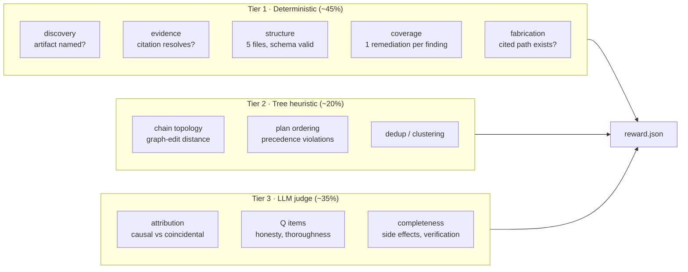
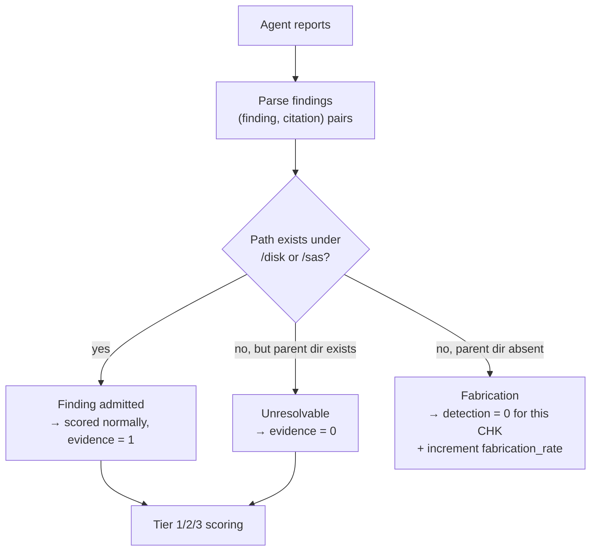
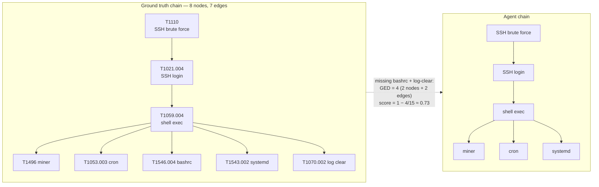
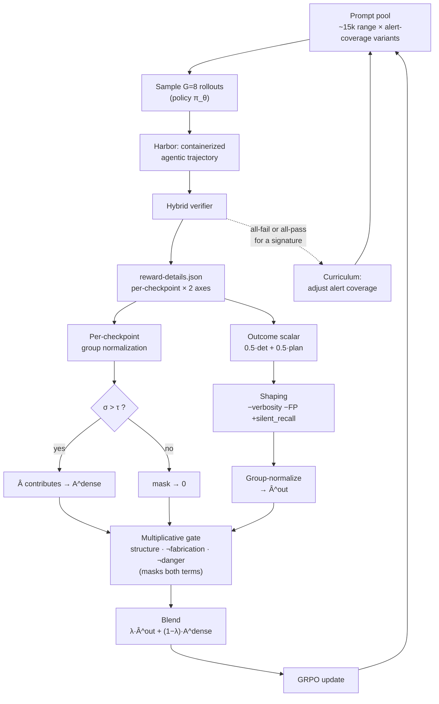

# 02 — Verifier Design, Theoretical Framework, and GRPO Reward

**Scope:** hybrid verifier (deterministic + tree-heuristic + LLM judge) for post-compromise
DFIR tasks, and the reward function derived from it.
**Substrate:** Harbor Reward Kit (`harbor-rewardkit`)
**Status:** design · **Owner:** _[your name]_ · **Last updated:** _[date]_

---

## 1. Design goals

| # | Goal | Why |
|---|---|---|
| G1 | Move ≥60% of scoring off the LLM judge | Judge cost dominates GRPO; agentic rollouts multiply it by group size |
| G2 | Separate detection and plan permanently | Dataset-card requirement; also the diagnostic signal we care about |
| G3 | Dense per-checkpoint output, not one scalar | Required for non-degenerate GRPO advantage |
| G4 | Hard-zero on fabrication | Rubric judges reward verbosity; must not train carpet-bombing |
| G5 | No-op floors near 0, oracle ceilings near 1 | Otherwise the verifier is measuring prose style |
| G6 | Deterministic where computable, judged only where genuinely not | Reproducibility and cost |

---

## 2. Theoretical framework

### 2.1 The scoring model we inherit

SecRespond scores every checkpoint on two independent axes:

```
Detection (max 3) = discovery(0/1) + evidence(0/1) + attribution(0/1)
Plan      (max 2) = correctness(0/1) + completeness(0/1)

CHK-score_c^a = s_c^a / M^a         M^det = 3, M^plan = 2
CHK-score_r^a = mean over checkpoints in range r
CAP-score^a   = mean over checkpoints mapped to a capability item
```

Some checkpoints are detection-only, some plan-only; N/A dimensions are excluded from their
aggregates rather than scored zero.

Negative rules (inherited, and load-bearing for RL):

| Rule | Effect |
|---|---|
| Fabrication — invents non-existent CVEs, files, logs | detection → **0** |
| Wrong attribution | attribution sub-score → 0 |
| Dangerous advice without risk flag | plan → **0** |
| "Probably checked but didn't report" | **no credit** |

### 2.2 The verifiability spectrum

The key insight: the five sub-scores are **not equally verifiable**. Sorting them by how
much LLM judgment they actually require is what buys us G1 and G6.



**Tier 1 is possible only because of the attack manifest.** For our generated corpus, the
attack script emits a machine-readable list of every artifact it wrote. Discovery collapses
to a set-membership test. For the SecRespond eval set (no manifest published) we
reconstruct an equivalent from `checklist.md` — a one-off extraction, done once per range.

### 2.3 Grounding as a gate, not a score

Citation resolution runs **before** all three tiers and acts as a mask. Citations resolve
against the two read-only evidence roots the agent is given: `/disk` (the forensic image)
and `/sas` (the security-product feed). The three-way branch is decided by the filesystem,
not by heuristics — this is what makes "plausible but wrong" separable from "invented":

- **Resolves** — the cited path exists under `/disk` or `/sas`. Finding admitted, scored
  normally, evidence sub-score = 1.
- **Unresolvable but plausible** — the path does not exist, but its *parent directory* does
  exist under an evidence root (a wrong line or filename inside a real directory). Evidence
  sub-score = 0; **not** counted as fabrication.
- **Fabrication** — neither the path nor its parent directory exists under any evidence
  root. detection = 0 for this CHK and `fabrication_rate` is incremented.



This single mechanism does three jobs: it computes the evidence sub-score without a judge,
it implements the fabrication negative rule mechanically while distinguishing a wrong
citation from an invented one, and it kills the ReCon-style failure where models echo prompt
content back as if it were evidence.

> **Non-file evidence.** Findings whose evidence is inherently not a file on disk — a network
> connection (e.g. the outbound mining channel) or events recovered after a log wipe — cite
> the corresponding `/sas` alert entry or a surviving on-disk source (`btmp`/`wtmp`, journald,
> a secondary log). Both live under an evidence root, so neither is treated as fabrication.

### 2.4 Failure taxonomy the verifier must distinguish

A verifier that reports a single number cannot tell these apart, and they need different
fixes:

| Mode | Signature in the verifier output |
|---|---|
| **Reactive tunnel vision** (P1) | High alerted-recall, low silent-recall |
| **Ungrounded assertion** (P2) | High discovery, low grounding rate |
| **Fabrication** | Non-zero fabrication rate |
| **Misattribution** (P3) | High discovery + evidence, low attribution; high chain graph-edit distance |
| **Detect-then-abandon** (P4) | High detection, low plan-coverage |
| **Unverified closure** (P4) | High plan-correctness, low plan-completeness |
| **Over-prediction** | High recall, high FP rate on decoys |
| **Boundary-stopping** | Recall drops sharply outside the categories named in a supplied skill |

Every one of these is directly measurable from the tier outputs. That mapping is the
justification for the whole design.

---

## 3. Verifier implementation plan

### 3.0 Design invariant — one verifier, every range in the subdomain

The verifier is **not** written per range. It is a single, fixed reward package that is
fully parametrized by `manifest.json`. The only thing that changes between the ssh-miner
range, a shiro-fastjson range, or any generated range in the subdomain
(post-compromise host forensics & remediation planning) is the manifest — never the
criterion code, the tiers, the gates, or the aggregation.

Concretely, every per-range specific in this document (which artifact, which path, which
match needle, which weight, which precedence rule, which decoy) is a *field of the manifest*,
and the Tier-1/2 criteria are **emitted from the manifest** by `build.py`:

```
manifest.json  ──build.py──▶  tests/**/*.py + *.toml   (this range's instantiation)
     ▲                                    │
     └──────── same schema, any range ────┘
```

This is what makes R5 (a standard, verifiable format that generalizes across the whole
subdomain) real: implement the verifier once against the schema (§4.2 of doc 03), and every
range that emits a conformant manifest is scorable with zero new verifier code. The worked
ssh-miner code in doc 04 §6 is this generic package with ssh-miner's manifest bound in — not
a bespoke verifier. The hand-authored inputs (§3.5 Tier-3 rubric prompts) are likewise
written against manifest fields, not literal artifacts, so they transfer unchanged.

### 3.1 Reward Kit primitives we use

| Feature | Use |
|---|---|
| Directory-per-reward | `tests/detection/`, `tests/planning/`, `tests/structure/`, `tests/grounding/` → separate reward keys |
| `@criterion` Python | All Tier 1 and Tier 2 checks |
| `judge.toml` | Tier 3 only |
| `@criterion(shared=True)` | Manifest loader, report parser, citation resolver — reused across dirs |
| `weight=` | Per-checkpoint weighting |
| `[scoring] aggregation` | `weighted_mean` within judges; `required_pass` for the structure gate |
| `tests/reward.toml` `[[reward]]` | Adds aggregate keys without collapsing per-dimension ones |
| `isolated=True` | Any criterion that executes commands against the disk |
| `rewardkit /tests/v1 /tests/v2` | A/B two verifier designs, prints a diff table |
| `[all]` extras | PDF/DOCX/XLSX/image reading — required for Δ1 multimodal CTI |
| `reward-details.json` | Per-criterion scores + judge reasoning; **this is the GRPO input** |

### 3.2 Directory layout

```
tests/
├── test.sh                     # uvx --with harbor-rewardkit rewardkit /tests
├── manifest.json               # ground truth (generated corpus) or extracted (SecRespond)
├── criteria.py                 # shared=True: loader, parser, citation resolver
├── reward.toml                 # aggregate keys
│
├── structure/                  # gate — required_pass
│   ├── five_files_exist.py
│   ├── nonempty_and_parses.py
│   └── required_sections.py
│
├── grounding/                  # Tier 1 — mask + evidence sub-score
│   ├── citations_resolve.py
│   └── no_fabrication.py
│
├── detection/
│   ├── discovery.py            # Tier 1 — manifest set-membership
│   ├── silent_recall.py        # Tier 1 — headline metric
│   ├── chain_topology.py       # Tier 2 — graph-edit distance
│   └── attribution.toml        # Tier 3 — judge
│
├── planning/
│   ├── coverage.py             # Tier 1 — one step per detected finding
│   ├── verification.py         # Tier 1 — step contains a check action
│   ├── ordering.py             # Tier 2 — precedence violations
│   └── quality.toml            # Tier 3 — judge: side effects, completeness
│
└── quality/
    └── q_items.toml            # Tier 3 — honesty, calibration, business impact
```

### 3.3 Tier 1 — deterministic criteria

```python
# tests/criteria.py
import json, re
from pathlib import Path
from rewardkit import criterion

# Citations MUST be backtick-delimited: `/abs/path` or `/abs/path:line`.
# The backticks are mandatory (not `?`): requiring them stops bare slashes in
# prose — "and/or", "TCP/IP", "input/output", "24/7" — from being mis-parsed as
# paths and then flagged as fabrication. The path class also excludes ':' so the
# optional ':line' suffix is split unambiguously.
CITE = re.compile(r'`(/[^`\s:]+)(?::(\d+))?`')

# Read-only evidence roots the agent is given; citations resolve against either.
EVIDENCE_ROOTS = (Path("/disk"), Path("/sas"))

@criterion(shared=True)
def _manifest(workspace: Path) -> dict:
    return json.loads((Path("/tests") / "manifest.json").read_text())

@criterion(shared=True)
def _findings(workspace: Path) -> list[dict]:
    """Parse (claim, citation) pairs out of the agent's markdown reports."""
    out = []
    for name in ("intrusion-report.md", "vuln-report.md", "baseline-report.md"):
        text = (workspace / name).read_text(errors="replace")
        for line in text.splitlines():
            cites = CITE.findall(line)
            if cites:
                out.append({"claim": line.strip(), "citations": cites, "source": name})
    return out

@criterion(shared=True)
def _grounding(workspace: Path):
    """Return a classifier path -> {'resolved','plausible','fabricated'} so every
    criterion shares one filesystem view of the evidence roots (see §2.3)."""
    def classify(path: str) -> str:
        rel = path.lstrip("/")
        if any((root / rel).exists() for root in EVIDENCE_ROOTS):
            return "resolved"
        if any((root / rel).parent.exists() for root in EVIDENCE_ROOTS):
            return "plausible"      # wrong file/line inside a real directory
        return "fabricated"         # parent directory absent under every root
    return classify
```

```python
# tests/detection/discovery.py
import rewardkit as rk
from pathlib import Path
from rewardkit import criterion

@criterion(description="CHK {chk}: artifact {artifact} discovered")
def discovered(workspace: Path, chk: str, artifact: str, match=None) -> float:
    """Pure discovery sub-score (0/1): is the artifact named in a report?

    Evidence/grounding is scored once, by the grounding gate (§2.3). This criterion
    no longer folds evidence in (the old 0.5 return double-counted it and broke the
    per-sub-score separability the scoring model requires). `match` supplies extra
    content needles for artifacts identified by contents rather than path.
    """
    needles = [artifact] + list(match or [])
    for f in rk.shared._findings(workspace):
        hay = f["claim"] + " " + " ".join(c[0] for c in f["citations"])
        if any(n in hay for n in needles):
            return 1.0
    return 0.0

# Emitted by build.py, one call per manifest artifact. Weights live in manifest.json
# (single source of truth); silent artifacts are upweighted to 2.0. CHK-01 and CHK-02
# share a path (miner process vs binary), so `match` needles keep them separable.
rk.discovered("CHK-01", "/tmp/.X11-unix/.xorg", match=["process", "pid"], weight=1.0)
rk.discovered("CHK-02", "/tmp/.X11-unix/.xorg", match=["binary", "hash"], weight=1.0)
rk.discovered("CHK-11", "/var/spool/cron/root",                           weight=1.0)
rk.discovered("CHK-12", "/root/.bashrc",                                  weight=2.0)  # silent
rk.discovered("CHK-03", "/home/devops/.bash_history", match=["hydra", "brute"], weight=2.0)  # silent
```

```python
# tests/detection/silent_recall.py — the headline metric
@criterion(description="recall over non-alerted ground-truth artifacts")
def silent_artifact_recall(workspace: Path) -> float:
    m = rk.shared._manifest(workspace)
    silent = [a for a in m["artifacts"] if not a["alerted"]]
    found = sum(1 for a in silent if _mentioned(workspace, a))
    return found / max(len(silent), 1)
```

```python
# tests/grounding/no_fabrication.py
@criterion(description="no citation invents a path whose directory does not exist")
def no_fabrication(workspace: Path) -> bool:
    classify = rk.shared._grounding(workspace)
    for f in rk.shared._findings(workspace):
        for path, _ in f["citations"]:
            if classify(path) == "fabricated":   # parent dir absent under /disk and /sas
                return False
    return True                                  # 'plausible' (wrong file, real dir) is OK
```

```python
# tests/planning/verification.py
VERIFY = ("verify", "confirm", "re-run", "recheck", "validate", "systemctl status",
          "restart", "test", "check that")

@criterion(description="remediation step for {artifact} includes a verification action")
def step_verified(workspace: Path, artifact: str) -> bool:
    plan = (workspace / "remediation-plan.md").read_text(errors="replace")
    block = _step_block_for(plan, artifact)
    return bool(block) and any(v in block.lower() for v in VERIFY)
```

### 3.4 Tier 2 — tree/graph heuristics

Attack-chain reconstruction is a **structure** problem, not a text problem. Parse the
agent's chain into a DAG and compare topologically.

The ground-truth chain here is the canonical ssh-miner DAG (doc 04 §5): 8 nodes, 7 edges.



The GED counts both node and edge deletions — dropping 2 nodes also drops the 2 edges that
attached them — and the denominator is `nodes + edges = 8 + 7 = 15`, matching the formula
below.

```python
# tests/detection/chain_topology.py
@criterion(description="attack chain topology matches ground truth")
def chain_score(workspace: Path) -> float:
    gt   = _dag(rk.shared._manifest(workspace)["chain"])
    pred = _parse_chain(workspace / "intrusion-report.md")
    # normalized graph edit distance over (node set, edge set)
    return max(0.0, 1.0 - _ged(pred, gt) / (len(gt.nodes) + len(gt.edges)))
```

```python
# tests/planning/ordering.py
# Precedence rules the plan must respect, from the manifest:
#   contain-before-eradicate, eradicate-before-harden, rotate-creds-after-eradicate
@criterion(description="remediation plan has no precedence violations")
def ordering_ok(workspace: Path) -> float:
    steps = _ordered_steps(workspace / "remediation-plan.md")
    viol  = _count_precedence_violations(steps, rk.shared._manifest(workspace)["precedence"])
    return max(0.0, 1.0 - viol / max(len(steps), 1))
```

### 3.5 Tier 3 — the single judge

Only what genuinely needs judgment. **One judge model in training; three only for
eval-grade runs.**

```toml
# tests/detection/attribution.toml
[judge]
# Env-driven, never hardcoded to a family. The build refuses to run if the resolved
# judge shares a model family with the policy under evaluation (see "Judge hygiene").
judge  = "${REWARDKIT_JUDGE}"
files  = ["/app/intrusion-report.md", "/tests/manifest.json"]
weight = 1.0

# Prompt is templated over manifest fields, not literal artifacts, so it transfers to any
# range unchanged. build.py fills {chain} from manifest["chain"] (steps + depends_on).
[[criterion]]
description = """Given the ground-truth attack chain {chain}, is each attacker artifact
correctly attributed to its upstream cause (its `depends_on` step), rather than to an
unrelated cause or left unattributed? Award only where the report states the causal link
explicitly. Do not award credit for links the report does not state."""
type = "binary"
weight = 1.0

[[criterion]]
description = """Does the report distinguish attacker-caused artifacts from coincidental
or pre-existing host state? Penalise any attacker attribution of benign artifacts."""
type = "likert"
points = 3

[scoring]
aggregation = "weighted_mean"
```

```toml
# tests/planning/quality.toml
[judge]
judge = "${REWARDKIT_JUDGE}"    # env-driven; family must differ from the policy
files = ["/app/remediation-plan.md", "/app/intrusion-report.md"]

[[criterion]]
description = "Does the plan flag operations that could sever the control plane or disrupt production, rather than issuing them as bare commands?"
type = "binary"
weight = 2.0

[[criterion]]
description = "Does the plan address secondary risks (credential rotation, outbound blocking) and not only the visible artifact?"
type = "likert"
points = 5

[[criterion]]
description = "Does the plan confirm business services remain healthy after cleanup?"
type = "binary"
```

**Judge hygiene**

- Never judge with the same family as the policy. The judge is resolved from
  `REWARDKIT_JUDGE`; the build asserts `family(judge) != family(policy)` and aborts if they
  match, so an Anthropic policy (e.g. Opus 5) is never scored by an Anthropic judge.
- Provider-swap via `--judge` / `REWARDKIT_JUDGE` so the rubric is not pinned to one vendor.
- Log judge reasoning to `reward-details.json` — required for FM analysis in doc 01 §7.3.
- Re-score a 10% sample with a second family; report Spearman ρ (target ≥ 0.85).

### 3.6 Aggregation

```toml
# tests/reward.toml
[[reward]]
name = "detection"
aggregation = "weighted_mean"

[[reward]]
name = "plan"
aggregation = "weighted_mean"

[[reward]]
name = "quality"           # Q-dimension judge items; reported, eval-only by default
aggregation = "weighted_mean"   # (see §6 Q2 — whether it enters the reward is open)

[[reward]]
name = "reward"            # Harbor's parsed score
aggregation = "threshold"  # both axes ≥ 0.70
```

Yielding:

```json
{
  "structure": 1.0, "grounding": 0.82,
  "detection": 0.71, "plan": 0.48, "quality": 0.39,
  "reward": 0.0,
  "silent_artifact_recall": 0.33,
  "fabrication_rate": 0.0
}
```

### 3.7 Build order

| Step | Deliverable | Gate |
|---|---|---|
| 1 | `manifest.json` schema + extractor for one range | Manifest ↔ checklist agreement ≥ 95% |
| 2 | `structure/` + `grounding/` | No-op scores 0.00 on both |
| 3 | Tier 1 detection + planning | Oracle ≥ 0.95, no-op ≤ 0.05 |
| 4 | Tier 2 chain + ordering | Hand-perturbed chains rank correctly |
| 5 | Tier 3 judge | ρ ≥ 0.85 vs. second judge family |
| 6 | A/B vs. pure-judge baseline | `rewardkit /tests/hybrid /tests/judge_only` |
| 7 | Freeze v1, tag, record parity | Reproduce published ordering on SecRespond |

---

## 4. GRPO reward function

### 4.1 Blockers to clear first

| Blocker | Status |
|---|---|
| **Training data source** — SecRespond ships no manifest, so it cannot drive Tier 1 | Training data comes exclusively from the generator (doc 03); SecRespond stays held-out eval only. |
| **Closed-weight policy** — GRPO needs logprobs + gradients; Gemini 3.6 Flash is not open-weight | Verify whether an RL/GRPO tuning path exists for that model. If not: (a) open-weight policy via SkyRL, (b) GEPA prompt/scaffold optimization against the same reward — no gradients needed, (c) reject-sampling SFT on high-reward trajectories. |
| **Prompt diversity** — 10 ranges is far too few | ~3,000 generated ranges × ~5 alert-coverage variants ≈ 15,000 prompts (doc 03) |
| **Judge cost** | One judge; Tier 1+2 cover ~65% of criteria; cache per (range, report-hash) |

### 4.2 Per-checkpoint reward — the core construction

A single scalar per rollout produces dead groups. The rubric is already dense; use it.

For rollout *i* in group *G* on range *r*, define per checkpoint *c* and axis *a*:

```
s_{i,c,a} ∈ [0,1]                        normalized CHK-score
```

Group-normalize **per checkpoint**, and mask checkpoints with no variance:

```
μ_{c,a} = mean_i  s_{i,c,a}
σ_{c,a} = std_i   s_{i,c,a}

Â_{i,c,a} = (s_{i,c,a} − μ_{c,a}) / (σ_{c,a} + ε)   if σ_{c,a} > τ
          = 0                                       otherwise      (τ = 0.05)
```

Rollout-level dense advantage:

```
A^dense_i = Σ_{c,a} w_{c,a} · Â_{i,c,a}  /  Σ_{c,a} w_{c,a} · 1[σ_{c,a} > τ]
```

This is a dense, per-checkpoint advantage construction adapted to the two-axis rubric. It
matters because zero-variance groups are typically ~40% of all groups in agentic RL, and
>35% of queries sit in the zero-advantage regime in typical RLVR runs. Per-checkpoint
normalization recovers most of that: two rollouts that both land at overall 0.62 almost
never agree checkpoint-by-checkpoint.

### 4.3 Outcome scalar and advantage blend

The RL update needs one scalar per rollout, so the two axes are blended **here and only
here**. This is the sole place detection and plan are combined; the blended scalar is an
internal training signal and is never surfaced as a reported score — the reported keys stay
separate (doc 00 non-negotiable #2). The scalar is shaped, then gated, then group-normalized
into the outcome advantage, which is blended with the dense advantage from §4.2:

```
R^out_i    = 0.5 · detection_i + 0.5 · plan_i          # RL-internal scalar, never reported
R^shaped_i = shape(R^out_i)                            # §4.5 anti-hacking terms
R_i        = Gate_i · R^shaped_i                       # §4.4 multiplicative gates
Â^out_i    = (R_i − mean_i R_i) / (std_i R_i + ε)      # group-normalized outcome advantage

A_i = λ · Â^out_i + (1 − λ) · Gate_i · A^dense_i       λ = 0.3
```

The outcome advantage stabilizes the baseline; the dense term supplies gradient when the
outcome term is flat. Both terms carry `Gate_i`, so a fabricating or unsafe rollout earns
zero advantage from either path.

### 4.4 Hard gates — multiplicative, not additive

```
Gate_i = 1[structure_i = 1] · 1[fabrication_i = 0] · 1[dangerous_advice_i = 0]
```

`dangerous_advice_i = 1` iff the plan issues a control-plane-severing or production-disrupting
operation as a bare command with no risk flag — the negation of the Tier-3 `quality.toml`
"flags dangerous ops" binary.

Additive penalties get traded off; multiplicative ones do not. The gate's job is to kill
**fabrication** — evidence that does not exist on disk. Note what it does *not* do:
over-prediction (flagging real-but-benign artifacts — the "carpet-bomb" / review-not-detection
mode where models flag up to ~69% of samples as vulnerable) cites paths that *do* exist, so it
passes the fabrication gate. That mode is penalized instead by the `−β · fp_rate` shaping term
against decoy checkpoints (§4.5), not by the gate.

### 4.5 Anti-hacking shaping

Applied to the outcome scalar before gating and normalization (§4.3):

```
shape(R^out_i) = R^out_i − α · verbosity_excess_i − β · fp_rate_i + γ · silent_recall_i
                 α = 0.05,  β = 0.30,  γ = 0.20
```

| Term | Attacks |
|---|---|
| `verbosity_excess` = max(0, tokens/tokens_oracle − 1.5) | Judges reward long reports |
| `fp_rate` — decoys reported as malicious | Review-not-detection behaviour |
| `silent_recall` bonus | Directly reinforces the target capability P1 |

Re-tune α, β, γ whenever the verifier version changes.

### 4.6 Full pipeline



### 4.7 Curriculum control

Alert coverage is served from the same disk, so difficulty is free to modulate:

```
if  mean_i R_i > 0.85 for a signature:   remove one alert   (harder)
if  mean_i R_i < 0.10 for a signature:   restore one alert  (easier)
```

Self-calibrating, monotone, and no external difficulty schedule — the subtractive analogue
of the LLM-as-a-Tutor append-only design. One base range yields ≈5 distinct prompts at zero
generation cost (the four difficulty levels plus a 0% cold-start; more with silent/alerted
swaps — doc 03 §6.2).

### 4.8 Hyperparameters (starting point)

| Parameter | Value | Note |
|---|---|---|
| Group size G | 8 | Selective-rollout gating to skip zero-variance groups |
| λ (outcome blend) | 0.3 | ↑ if training destabilizes |
| τ (variance mask) | 0.05 | |
| ε (normalization floor) | 1e-6 | Guards σ→0 in the advantage denominators |
| α / β / γ | 0.05 / 0.30 / 0.20 | Re-tune per verifier version |
| KL coefficient | 0.0 | Following common GRPO practice; re-add if drift appears |
| Judges in training | 1 | 3 for eval only |
| Judge cache key | (range_id, sha256(reports)) | |

### 4.9 Monitoring

| Signal | Alarm |
|---|---|
| % zero-variance groups | > 25% → expand prompt pool or step curriculum |
| Mean report length | Rising with flat reward → verbosity hacking |
| Fabrication rate | Any upward trend → gate is leaking |
| Silent-artifact recall | The metric that should actually move |
| Judge ρ vs. held-out second judge | < 0.80 → judge drift; re-anchor |
| No-op score on current verifier | > 0.10 → verifier regression, halt |

---

## 5. Placeholders for our results

### 5.1 Verifier validation

| Check | Target | Observed |
|---|---|---|
| No-op score | < 0.10 | _[TBD]_ |
| Oracle score | > 0.90 | _[TBD]_ |
| Judge ρ (2 families) | ≥ 0.85 | _[TBD]_ |
| Human agreement (60 CHK) | κ ≥ 0.85 | _[TBD]_ |
| Tier-1 coverage | ≥ 45% of criteria | _[TBD]_ |
| Judge cost / trial | _[target]_ | _[TBD]_ |

### 5.2 Hybrid vs. judge-only A/B

> From `rewardkit /tests/hybrid /tests/judge_only`

| Reward key | hybrid | judge_only | diff |
|---|---|---|---|
| detection | _[TBD]_ | _[TBD]_ | |
| plan | _[TBD]_ | _[TBD]_ | |
| Cost/trial | _[TBD]_ | _[TBD]_ | |
| Variance across 3 seeds | _[TBD]_ | _[TBD]_ | |

### 5.3 Reward-hacking incidents

| Date | Behaviour observed | Verbatim excerpt | Mitigation | Verifier version |
|---|---|---|---|---|
| _[TBD]_ | | ``` ``` | | |

### 5.4 Training curves

_[TBD — attach: reward vs. step; silent-recall vs. step; % zero-variance groups; fabrication rate; mean report length]_

---

## 6. Open questions

1. Does per-checkpoint normalization introduce bias toward ranges with more checkpoints
   (45 in the shiro-fastjson Linux range vs. 20 in the rdp-service-abuse Windows range)?
   Consider normalizing by checkpoint count before blending.
2. Should Q-dimension items enter the reward at all, or be eval-only? They are the least
   verifiable and the most hackable.
3. Precedence rules for `ordering.py` — universal, or per-blueprint?
4. Is graph-edit distance the right chain metric, or should we use a path-coverage measure
   that tolerates extra correct detail?
