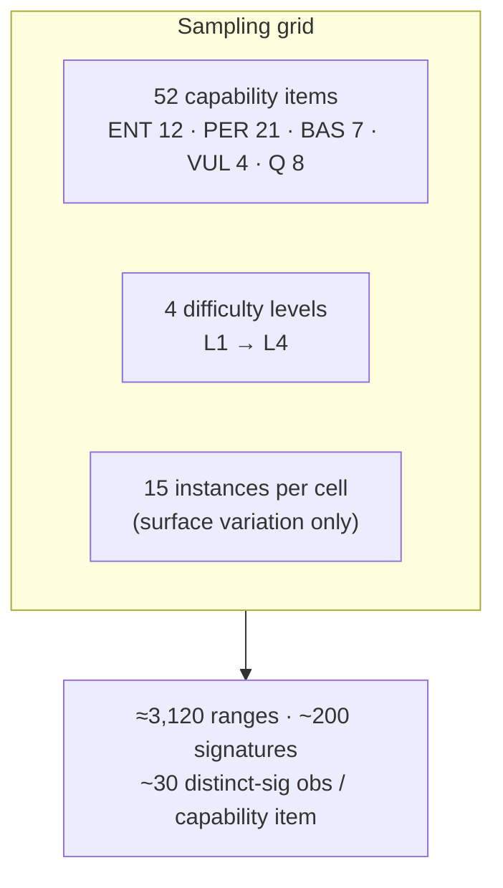
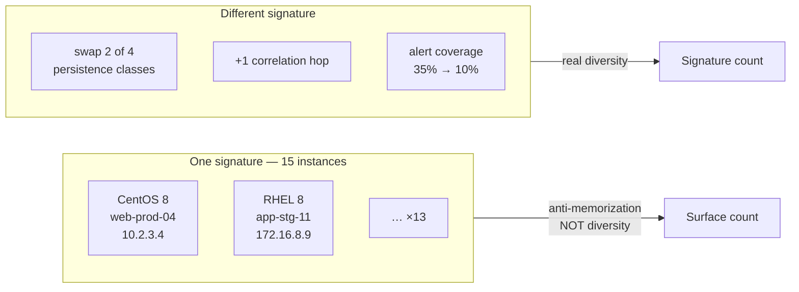
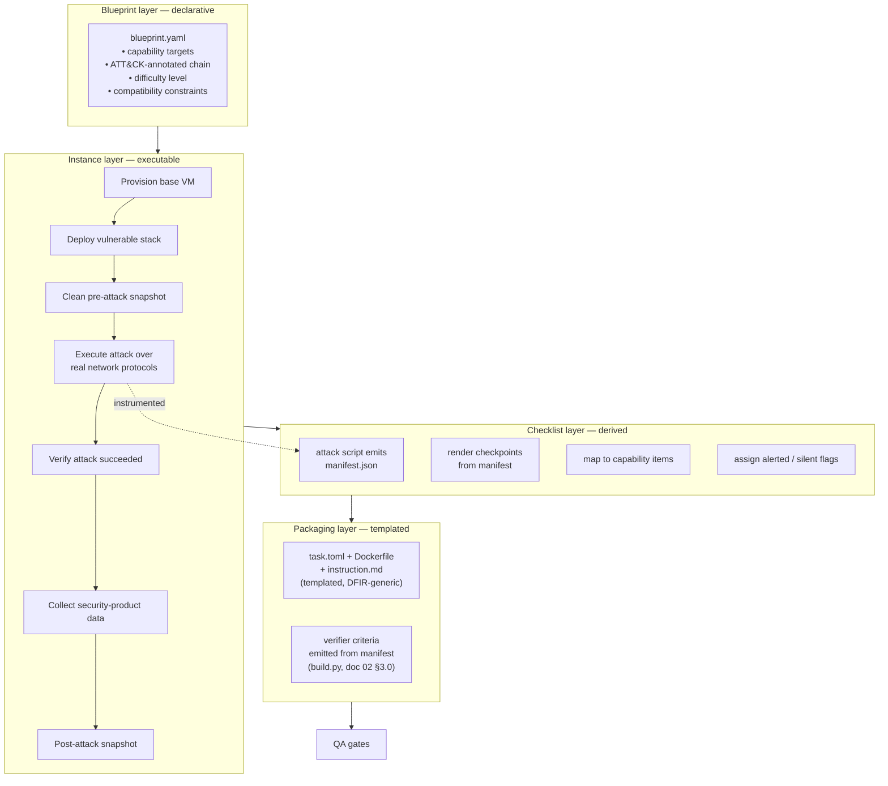
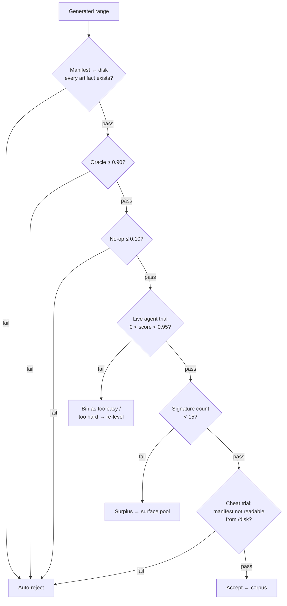
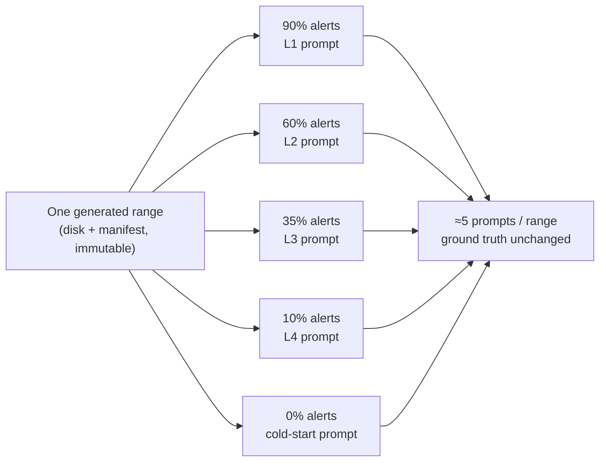

# 03 — Task Scalability and Regeneration Plan

**Goal:** a corpus of ~3,000 post-compromise DFIR ranges with manifest-derived ground truth,
and ~15,000 RL prompts derived from them — all produced by one generic generator, and all
scorable by the one manifest-parametrized verifier (doc 02 §3.0).
**Status:** design · **Owner:** _[your name]_ · **Last updated:** _[date]_

---

## 1. Why regenerate rather than augment

### 1.1 The engineering constraint (the real reason)

We regenerate — rather than mutate or augment SecRespond — because **manifest-derived ground
truth is a hard prerequisite for the deterministic verifier tier**. Human-labelled
checkpoints cannot be produced at 3,000-range scale, and without a machine-readable manifest,
Tier 1 (~45% of scoring) is impossible. SecRespond ships no such manifest, so even its own
ranges must be hand-extracted once for parity use (doc 04 §5). Regeneration and verifier
design are therefore the same project: the attack script that builds a range is also the
thing that produces its ground truth.

Contamination is the second reason. SecRespond stays a **held-out benchmark** and never
enters the training loop, so the parity numbers it anchors stay trustworthy. All training
data comes from ranges we generate ourselves.

### 1.2 Method spec — the generic build contract

Before generation, one `METHOD-SPEC.md` fixes the contract every range obeys: the capability
taxonomy (52 items, five dimensions), the two scoring axes (detection-3 / plan-2), the ATT&CK
chain model, and — most importantly — the **`manifest.json` schema** (§4.2). This spec is
what makes the generator and the verifier generic: any blueprint that compiles to a
schema-conformant manifest yields a complete, scorable task with no new task-specific or
verifier-specific code. Freeze the schema here; everything downstream keys off it.

---

## 2. Why naive combinatorics is the wrong target

The tempting calculation:

| Axis | Cardinality |
|---|---|
| Entry vector E | ~25 |
| Privesc path P | ~4 compatible per E |
| Persistence subset S (2–4 of 7 classes) | 91 |
| Anti-forensics subset A | ~8 |
| Impact I | ~4 |
| Alert coverage | 4 |

Product ≈ **1.1M**; after compatibility filtering ≈ **350k**.

**This number is meaningless.** Most combinations are *reasoning-isomorphic*:
Log4Shell → webshell → sudo-NOPASSWD → cron+systemd on CentOS 8, and
Struts-RCE → webshell → sudo-NOPASSWD → cron+systemd on RHEL 8, are the **same
investigation**. The agent takes the same steps in the same order. Training on both is
training twice on one problem.

**The real bound is build-and-QA throughput, not combinatorics.** So we stop maximizing
count and start maximizing coverage.

---

## 3. The design: a capability × difficulty grid

### 3.1 Sampling frame

The taxonomy gives 52 capability items — 12 ENT, 21 PER, 7 BAS, 4 VUL, 8 Q. Make that the
frame:

```
52 capability items × 4 difficulty levels × 15 instances  =  3,120 ranges
```

Each range naturally covers 5–12 capability items. Because the 15 instances per cell are
surface variants, that yields two very different counts, and we report **both** — conflating
them is exactly the size-claim dishonesty this doc keeps warning against (§3.3):

- **Distinct-signature observations per item** — the statistically meaningful count. The
  grid gives ~200 distinct signatures (§8.1); each exercises ~8 capability items, so
  ≈ 200 × 8 / 52 ≈ **~30 distinct-signature observations per capability item**, spread across
  the difficulty curve (~4 as the cell's primary target, the rest incidental).
- **Total range observations per item** — surface variants included: ≈ 3,000 × 8 / 52 ≈
  **~460**. This is training-time *exposure*, not independent evidence, so we never cite it
  as a diversity or statistical-power figure.

The ~30 distinct-signature figure is what "defensible statistical design" means here.
"350,000 combinations" is not, and neither is the inflated ~460.



### 3.2 Difficulty: one primary dial, three secondaries

Grounded in the published difficulty model: easy ranges have a single entry point, a linear
attack chain, and common persistence exposed in alerts; the hardest combine a broad attack
surface, cross-service or cross-runtime correlation, and deliberately disguised persistence.

| Dial | L1 | L2 | L3 | L4 |
|---|---|---|---|---|
| **Alert coverage** *(primary)* | 90% | 60% | 35% | 10% |
| Correlation hops to entry point | 1 | 2 | 3 | 4+ |
| Persistence classes | 2 | 3 | 4 | 5–6, ≥1 disguised |
| Runtimes / services spanned | 1 | 1 | 2 | 3+ |
| Anti-forensics | none | log clear | + timestomp | + selective wipe, decoys |

Alert coverage is primary because it directly modulates the failure the benchmark exists to
measure. The reference corpus does **not** hold it constant — it varies per range, from
~30% on the hardest ranges to ~55% on the easiest (ssh-miner, doc 04 §5). Turning it into a
controlled, per-serve parameter — rather than a fixed property baked into each range — is the
single highest-leverage change available. The grid values above (90/60/35/10) are the
nominal bucket centres we impose at serve time, not measurements of the reference corpus.

### 3.3 Distinctness: the reasoning signature

Before a range enters the pool, hash:

```python
signature = sha256((
    entry_family,                 # e.g. "java-deserialization"
    privesc_class,                # e.g. "sudo-nopasswd"
    tuple(sorted(persistence_classes)),
    correlation_hop_count,
    alert_coverage_bucket,
    tuple(sorted(anti_forensics)),
))
```

Cap at **15 instances per signature**. Those 15 differ only in *surface*: distro, hostnames,
paths, IPs, timestamps, benign noise, service names.

| Variation type | Adds reasoning diversity? | Use |
|---|---|---|
| Same signature, different surface | ❌ | Contamination control, train/eval splitting |
| Different signature | ✅ | Genuine new problem |

Track and **report both counts separately**. Anyone evaluating the corpus will ask, and
conflating them is the most common way benchmark size claims become dishonest.



---

## 4. The generator

### 4.1 Three layers



**The keystone is `manifest.json`.** The attack automation already knows every file it
wrote, every hook it installed, every credential it touched. Emitting that at attack time
converts checkpoint authoring — the expensive human step — into template rendering, and
simultaneously produces the ground truth the deterministic verifier needs.

**One pipeline, complete tasks.** A blueprint is the only per-range authored input. From it
the generator emits *everything else* mechanically: the disk image, the SAS feed, the
manifest, and — via templates that are identical across the subdomain — the full Harbor task
package (`task.toml`, `Dockerfile`, `instruction.md`, doc 04 §4) plus the verifier criteria
(`build.py` reads the manifest and writes the Tier-1/2 checks and Tier-3 rubric bindings,
doc 02 §3.0). Given a `(capability-item, checkpoint, difficulty)` target, the blueprint that
satisfies it therefore compiles to a complete, self-scoring task with no hand-written
task-specific or verifier-specific code. That is the R5 generalization guarantee made
operational.

### 4.2 Manifest schema (v0 sketch)

```jsonc
{
  "range_id": "javadeser-sudo-cron+bashrc+systemd-L3-0007",
  "signature": "a3f9…",
  "difficulty": 3,
  "platform": {"os": "centos", "version": "8", "arch": "x86_64"},
  "chain": [
    {"step": 1, "attck": "T1190", "desc": "Java deserialization RCE",
     "artifacts": ["/opt/tomcat/webapps/ROOT/static/js/analytics.jsp"]},
    {"step": 2, "attck": "T1548.003", "desc": "sudo NOPASSWD escalation",
     "artifacts": ["/etc/sudoers.d/99-java-ops"], "depends_on": [1]}
  ],
  "artifacts": [
    {"id": "ENT-F01-a", "path": "/opt/.../analytics.jsp", "kind": "webshell",
     "capability": "ENT-F01", "alerted": true,  "chk": "CHK-01"},
    {"id": "PER-I01-a", "path": "/root/.bashrc",           "kind": "shell-init",
     "capability": "PER-I01", "alerted": false, "chk": "CHK-12", "weight": 1.5}
  ],
  "decoys": [
    {"path": "/etc/cron.d/backup-nightly", "looks_malicious": true, "benign": true}
  ],
  "remediation": [
    {"chk": "CHK-12", "action": "remove injected line from /root/.bashrc",
     "verify": "grep -c '<marker>' /root/.bashrc == 0",
     "precedence": ["contain", "eradicate"], "risk_class": "runtime"}
  ],
  "precedence": ["contain", "eradicate", "harden", "rotate", "verify"],
  "alerts_emitted": ["CHK-01", "CHK-04"],
  "alert_coverage": 0.35
}
```

Everything the verifier needs — discovery sets, silent flags, citation targets, remediation
coverage, verification predicates, precedence, decoys — comes from this one file.

### 4.3 Storage

Full snapshots are the wrong model: the reference corpus is ~10 GB for 10 ranges. Shared
base per distro + attack delta only:

| Item | Naive | Layered |
|---|---|---|
| Per range | ~1 GB | ~150 MB delta |
| 3,120 ranges | ~3.1 TB | ~470 GB + ~50 GB bases |

Content-address the deltas so identical surface variants dedupe.

### 4.4 Build cost

| Stage | Per range | × 3,120 |
|---|---|---|
| Provision + attack + snapshot | ~30 min compute | ~1,560 machine-hours |
| Oracle run (manifest → reports) | 1 cheap pass | 3,120 |
| No-op run (empty reports) | 1 cheap pass | 3,120 |
| Live agent trial | 1 full rollout | 3,120 |

At 100 concurrent workers: **~16 h wall clock** for generation. QA dominates cost, not
generation.

---

## 5. QA gates

Adopt Terminal-Bench 3.0's pipeline shape — static checks, an implementation rubric,
Docker/oracle/no-op validation, live agent trials, adversarial "cheat" trials — with these
domain-specific gates:



| Gate | Threshold | Rationale |
|---|---|---|
| Manifest ↔ disk consistency | 100% | Broken ground truth poisons Tier 1 |
| Oracle | ≥ 0.90 | Rubric must be reachable |
| **No-op** | **≤ 0.10** | **Most important gate.** A verbose, confident, evidence-free report scores non-trivially against any LLM judge |
| Live agent trial | 0 < s < 0.95 | Neither impossible nor trivial |
| Signature cap | ≤ 15 | Prevents fake diversity |
| Cheat trial | manifest/checklist unreachable from `/disk` | Prevents ground-truth leakage into the environment |
| Refusal check | ≥ 1 model produces output | Avoids ranges that only measure safety policy |

The refusal gate exists because the reference study lost an entire model-range cell to a
blanket safety refusal on a worm scenario. Prefer neutral framing and avoid live malware
samples in generated content.

---

## 6. From 3,000 ranges to 15,000 RL prompts

Alert coverage is served from `sas-mock/`, **not** baked into the disk. Difficulty is
therefore free to vary at serve time.



`3,000 ranges × ~5 variants ≈ 15,000 prompts` — comfortably clear of the regime where
>35% of queries yield zero advantage.

### 6.1 Adaptive curriculum

```
observe group reward variance per signature
  all rollouts succeed  → remove an alert   (harder)
  all rollouts fail     → restore an alert  (easier)
```

Self-calibrating, monotone, no external schedule. This is the subtractive analogue of the
append-only "tutor" design used for non-verifiable RL, and it costs nothing because the
disk never changes.

### 6.2 Structural augmentation (the long tail)

Apply **after** per-checkpoint advantage and alert ablation, not before.

| Augmentation | Cost | Changes what the agent must do? |
|---|---|---|
| Persistence re-composition (swap 2 of 4 mechanisms) | attack-script param | ✅ new signature |
| **Decoy injection** (benign artifacts that look malicious) | manifest param | ✅ + yields FP checkpoints the reference corpus lacks |
| Silent/alerted swap (same artifacts, flip which alert) | serve-time | ✅ isolates transcription vs. investigation |
| Cross-runtime extension (+1 service in chain) | blueprint | ✅ the hardest published axis |
| Surface rename / re-IP / timestamp shuffle | trivial | ❌ contamination control only |

### 6.3 Splitting

Hold out **entire signature classes**, never random ranges. A random split leaves surface
variants of training problems in the eval set and inflates every number.

```
train  : 80% of signatures
val    : 10% of signatures (curriculum tuning)
test   : 10% of signatures (never touched)
+ SecRespond : external held-out, never in training (uncontaminated; no manifest)
```

---

## 7. Roadmap

Phase IDs are used verbatim in the README critical path.

| Phase | Deliverable | Exit criterion |
|---|---|---|
| **P0** Method spec | `METHOD-SPEC.md` — taxonomy, axes, chain model, frozen `manifest.json` schema | Schema frozen; spec reviewed |
| **P1** Manifest + verifier v1 | Extractor + Tier 1–3 on one hand-built range (ssh-miner, doc 04) | No-op ≤ 0.10, oracle ≥ 0.90 |
| **P2** Generator v1 | End-to-end for 1 blueprint × 3 instances, task package + verifier emitted | Manifest ↔ disk 100% |
| **P3** Pilot corpus | 50 ranges, 5 blueprints, 4 difficulty levels | All QA gates; live-agent score in 0.2–0.7 |
| **P4** Parity | Harbor adapter run on SecRespond's 10 ranges | Reproduces published aggregate detect>plan and ENT>PER ordering (per-range inversions allowed) |
| **P5** Scale | 3,000 ranges | ~30 distinct-signature obs/capability item; ≤15 per signature |
| **P6** RL | 15,000 prompts, GRPO/GEPA run | <25% zero-variance groups; silent-recall improves |

---

## 8. Placeholders for our results

### 8.1 Corpus statistics

| Metric | Target | Actual |
|---|---|---|
| Distinct signatures | ~200 | _[TBD]_ |
| Total ranges | ~3,000 | _[TBD]_ |
| Mean instances / signature | ≤ 15 | _[TBD]_ |
| Capability items with ≥25 distinct-signature obs | 52/52 | _[TBD]_ |
| Ranges rejected by QA | — | _[TBD]_ |
| Rejection reason breakdown | — | _[TBD]_ |
| Storage | < 600 GB | _[TBD]_ |
| Generation wall clock | < 24 h | _[TBD]_ |

### 8.2 Difficulty calibration

| Level | Target solve rate | Observed (best model) |
|---|---|---|
| L1 | 70–85% | _[TBD]_ |
| L2 | 50–70% | _[TBD]_ |
| L3 | 25–45% | _[TBD]_ |
| L4 | 5–20% | _[TBD]_ |

### 8.3 Generator failure log

| Date | Blueprint | Failure | Root cause | Fix |
|---|---|---|---|---|
| _[TBD]_ | | | | |

### 8.4 Isomorphism audit

> Sample 50 pairs from *different* signatures; have an expert judge whether the
> investigations genuinely differ. Target ≥ 90% judged distinct.

_[TBD]_
