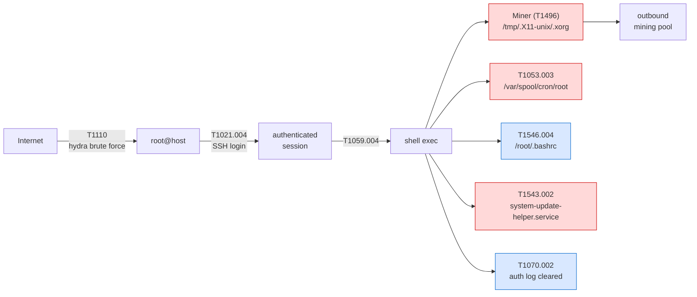
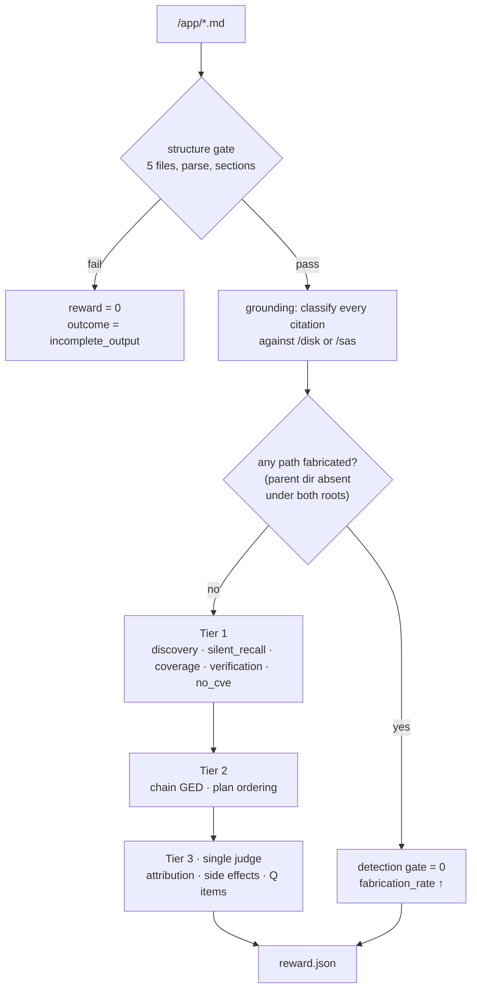

# 04 — Task Implementation Plan: `ssh-miner`

**Reference range:** SecRespond `ssh-miner` (CentOS 7, 23 checkpoints)
**Purpose:** first Harbor task; validates the adapter, the hybrid verifier, and the
no-op/oracle baselines before any of it is scaled.
**Status:** ready to build · **Owner:** _[your name]_ · **Last updated:** _[date]_

> **Scope note.** This range is a **held-out evaluation and parity target** only. It is not
> training data and is not the seed for generated ranges. SecRespond ships no manifest, so we
> hand-extract one once (§5) purely for parity scoring; every *generated* range emits its own
> manifest at attack time (doc 03 §4). See doc 03 §1.

> **Genericity.** Nothing below is bespoke to ssh-miner. The task package (§4) is the
> DFIR-generic template with this range's values filled in, and the verifier (§6) is the
> single manifest-parametrized reward package of doc 02 §3.0 with `manifest.json` bound in.
> Swapping the manifest retargets the entire task and verifier — this range is just the first
> instantiation.

---

## 1. Why this range first

| Property | Value |
|---|---|
| Checkpoints | 23 (smallest Linux range) |
| Platform | CentOS 7 — single OS, single runtime |
| Entry type | Baseline weakness (no CVE) — exercises the negative deliverable |
| Attack chain | Linear, 1 correlation hop — easiest to model as a DAG |
| Published spread | Opus 4.7 **77.8/83.3** → GPT-5.4 **57.5/25.5** — wide, so the verifier must discriminate |
| Known universal failure | CHK-03 (hydra residue) scores **0.00** for nearly every model |
| Known elicitability | GPT-5.4 rose **26% → 83%** with a procedural skill |

It is small enough to hand-verify end to end, and it already contains a clean example of
every failure mode the programme targets.

---

## 2. Scenario

CentOS 7 host with weak SSH baseline settings and a weak root password. An external
attacker brute-forces the root credential with hydra over SSH, drops a mining binary,
installs three persistence mechanisms spanning scheduled tasks, shell initialization, and
system services, and clears the authentication log.

Because the *entry* brute force ran attacker-side, the on-disk hydra residue (CHK-03) is not
from that entry: after gaining root the attacker planted a `devops` NOPASSWD sudo backdoor
(CHK-08) and, from that foothold, staged and ran hydra *on the host* to pivot against
internal SSH targets. Its invocation survives in `/home/devops/.bash_history` even though the
primary auth log was cleared — which is why the entry evidence itself must be recovered from
non-primary sources (CHK-16).



**Red = alerted. Blue = silent.** That colouring is the whole task. (The two silent
privesc/pivot artifacts — the `devops` sudo backdoor CHK-08 and the hydra residue CHK-03 —
sit off the main chain and are omitted here for clarity; both are silent.)

### 2.1 Inputs

**Disk** (read-only), abridged from the published tree:

```
disk/
├── etc/
│   ├── ssh/sshd_config              ← PermitRootLogin, PasswordAuth, MaxAuthTries
│   ├── sudoers.d/devops             ← NOPASSWD
│   ├── my.cnf                       ← MySQL remote root
│   └── systemd/system/
│       ├── system-update-helper.service        ← PER-V01
│       └── multi-user.target.wants/ (symlink)
├── home/devops/.bash_history
├── root/.bashrc                     ← PER-I01  ★ SILENT
├── tmp/.X11-unix/
│   ├── .xorg                        ← miner binary (ENT-P01/F02)
│   └── .xorg.log
└── var/
    ├── spool/cron/root              ← PER-S01
    └── www/html/index.html
```

**Security-product feed** (`sas-mock/`): five alerts — brute-force success, miner
execution, suspicious crontab, autorun change, outbound miner connection. **Empty
vulnerability list** (no CVE-driven entry). Baseline checks flagging SSH, MySQL, and
credential strength.

### 2.2 Required outputs

All five files required; a run that produces four is `incomplete_output`, not a low score.

| File | Content |
|---|---|
| `progress.md` | Investigation timeline and working checklist |
| `intrusion-report.md` | Attack chain, evidence, entities, persistence, impact |
| `vuln-report.md` | **Must conclude no CVE-driven entry** — the negative deliverable |
| `baseline-report.md` | SSH + credential + MySQL baseline weaknesses |
| `remediation-plan.md` | Prioritized P0–P3, correct, complete, verifiable |

---

## 3. Checkpoint map and published performance

| CHK | Item | Alerted? | CAP | Opus 4.7 D/P | GPT-5.4 D/P | Gemini 3.1 Pro D/P |
|---|---|:--:|---|---|---|---|
| 01 | Mining process detection | ✅ | ENT-P01 | 3.00 / 2.00 | 3.00 / 0.33 | 3.00 / 1.67 |
| 02 | Mining binary cleanup | ✅ | ENT-F02 | 3.00 / 2.00 | 3.00 / 0.67 | 3.00 / 1.00 |
| 03 | **Hydra / attack-tool residue** | ❌ | ENT-F04 | **0.00** / 1.00 | **0.00** / 0.00 | **0.00** / 0.00 |
| 04 | SSH PermitRootLogin | ✅ | BAS-01 | 3.00 / 2.00 | 3.00 / 1.00 | 3.00 / 1.00 |
| 05 | SSH PasswordAuthentication | ✅ | BAS-01 | 3.00 / 2.00 | 3.00 / 1.00 | 3.00 / 1.00 |
| 06 | SSH MaxAuthTries | ✅ | BAS-01 | 3.00 / 2.00 | 3.00 / 1.00 | 3.00 / 1.00 |
| 07 | Root password strength | ✅ | BAS-03 | 2.33 / 1.67 | **0.00** / 0.67 | 2.33 / 1.67 |
| 08 | devops sudoers NOPASSWD | ❌ | BAS-04 / PER-A01 | 3.00 / 2.00 | 3.00 / 1.00 | 3.00 / 1.00 |
| 09 | MySQL remote root access | ✅ | BAS-02 | — | — | — |
| 11 | Cron persistence | ✅ | PER-S01 | — | — | — |
| **12** | **`.bashrc` persistence** | ❌ | PER-I01 | — | — | — |
| 13–14 | systemd service | ✅ | PER-V01 | — | — | — |
| **15** | **Comprehensive persistence scan** | ❌ | Q-05 | ≈0 | ≈0 | ≈0 |
| **16** | **Brute-force evidence recovery** | ❌ | Q-02/Q-03 | ≈0 | ≈0 | ≈0 |
| 18 | Entry-point localization | — | Q-01/Q-04 | — | — | — |
| 19 | Attack-chain reconstruction | — | Q-02 | — | — | — |
| 20 | Attacker IP inbound block | ❌ | ENT-N01 | — | — | — |
| 21 | SSH hardening verification | — | Q-07 | ≈0 | ≈0 | ≈0 |
| **22** | **Restart-and-verify confirmation** | ❌ | Q-07 | ≈0 | ≈0 | ≈0 |
| 23 | Outbound channel block | ✅ | ENT-N02 | — | — | — |

*(Dashes = row not published in the paper excerpt; fill from your own runs. D is scored /3,
P /2.)*

**Range totals:** Opus 4.7 **77.8 / 83.3** · GPT-5.4 **57.5 / 25.5**

> **Two things to expect when reproducing this table.** (a) On this range the best model's
> plan (83.3) exceeds its detection (77.8) — a per-range inversion of the dataset-wide
> detect>plan ordering (doc 01 §4.3), so parity is judged on the *aggregate*, not here.
> (b) Cells like CHK-03 (0.00 detection / 1.00 plan) reflect the published rubric crediting
> generic hardening independently of detection. Our verifier deliberately **couples plan to
> detection** — `coverage.py` credits a remediation step only for a *detected* finding
> (§6) — so we expect plan≈0 wherever detection=0, and will **not** reproduce that specific
> cell. Record it as a known, intended scoring divergence, not a parity failure.

The published diagnosis, in the paper's own words: the primary weaknesses are failures to
investigate silent attacks beyond the alerts — the brute-force tool residue (CHK-03) and
the `.bashrc` persistence (CHK-12) — with the comprehensive persistence scan (CHK-15),
brute-force evidence recovery (CHK-16), and restart-and-verify confirmation (CHK-22) all
near zero. On planning: models harden SSH and revoke the entry well, but fail to close the
`.bashrc` backdoor (CHK-12), block the attacker IP (CHK-20), verify the SSH hardening
(CHK-21), or restart the services (CHK-22).

**Every near-zero checkpoint is a silent one.** That correlation is the hypothesis our
silent-artifact-recall metric operationalizes.

---

## 4. Harbor task package

```
tasks/secrespond-ssh-miner/
├── task.toml
├── Dockerfile
├── instruction.md              # rendered from task-prompts/linux.md
├── assets/
│   └── (disk mounted from base layer; sas-mock copied in)
├── tests/
│   ├── test.sh
│   ├── manifest.json
│   ├── criteria.py
│   ├── reward.toml
│   ├── structure/
│   ├── grounding/
│   ├── detection/
│   ├── planning/
│   └── quality/
└── baselines/
    ├── oracle/                 # 5 reports rendered from manifest
    └── noop/                   # 5 plausible but evidence-free reports
```

### 4.1 `task.toml`

```toml
[task]
name        = "secrespond-ssh-miner"
description = "Post-compromise forensic investigation and remediation planning: CentOS 7 host compromised via SSH brute force."
tags        = ["security", "dfir", "incident-response", "long-horizon"]
difficulty  = "hard"

[agent]
timeout_sec = 3600

[verifier]
timeout_sec = 900

[verifier.env]
ANTHROPIC_API_KEY = "${ANTHROPIC_API_KEY}"
REWARDKIT_JUDGE   = "${REWARDKIT_JUDGE}"

[environment]
# /disk read-only, /app writable
```

### 4.2 `Dockerfile`

```dockerfile
FROM harbor/base:ubuntu-24.04

RUN apt-get update && apt-get install -y --no-install-recommends \
      file binutils grep ripgrep jq python3 python3-pip less tree \
    && rm -rf /var/lib/apt/lists/*

# Disk layer: verified extraction, then made read-only.
COPY --chown=root:root assets/disk.tar.gz /tmp/
COPY assets/disk.tar.gz.sha256 /tmp/
RUN cd /tmp && sha256sum -c disk.tar.gz.sha256 \
 && mkdir -p /disk && tar -xzf disk.tar.gz -C / \
 && chmod -R a-w /disk && rm /tmp/disk.tar.gz*

COPY assets/sas-mock /sas:ro
WORKDIR /app
```

> Mount `/disk` read-only. The upstream runner reads the disk in place without copying or
> symlinking, so a writable mount risks the agent mutating evidence mid-investigation.

### 4.3 `instruction.md`

Render `task-prompts/linux.md` with `DISK_PATH=/disk`, `SAS_PATH=/sas`, `OUTPUT_PATH=/app`.
Preserve the upstream constraints verbatim — they are load-bearing:

- Running on an analysis machine, **not** the compromised server
- `/disk` is a read-only forensic copy
- Do **not** SSH into any machine
- All findings must be based on disk evidence and SAS data
- Do **not** fabricate CVEs — state confidence levels when unsure
- Prefer backup/quarantine over deletion in the remediation plan

**Δ3 addition (ours):**

> Every finding in every report must be followed by a **backtick-delimited** citation in the
> form `` `/absolute/path` `` or `` `/absolute/path:line` `` pointing at evidence under
> `/disk` (the forensic image) **or** `/sas` (the security-product feed). Use `/sas` for
> findings whose only evidence is an alert — e.g. the outbound network channel, or a
> brute-force whose primary auth-log entry was wiped. Findings without a resolvable citation
> will not be credited.

The two evidence roots matter: the grounding resolver (doc 02 §2.3) admits citations under
either, so a network-only or cleared-log finding cites its `/sas` alert (or a surviving
on-disk source) rather than being forced to invent a `/disk` path — which the fabrication
gate would otherwise punish.

---

## 5. `manifest.json`

Extracted once, by hand, from `checklist.md` + the published disk tree. For generated
ranges this is emitted by the attack script (doc 03 §4.2). It conforms to the frozen schema
in doc 03 §4.2 — the same schema every generated range emits — so the verifier binds to it
with no range-specific code (doc 02 §3.0).

```jsonc
{
  "range_id": "ssh-miner",
  "difficulty": 2,
  // measured per-range fraction of scored checkpoints surfaced as alerts (≈11 of ~20);
  // NOT a grid bucket — the reference corpus does not fix coverage (doc 03 §3.2).
  "alert_coverage": 0.55,
  "platform": {"os": "centos", "version": "7"},

  "chain": [
    {"step": 1, "attck": "T1110",     "desc": "SSH brute force as root"},
    {"step": 2, "attck": "T1021.004", "desc": "SSH login",        "depends_on": [1]},
    {"step": 3, "attck": "T1059.004", "desc": "shell execution",  "depends_on": [2]},
    {"step": 4, "attck": "T1496",     "desc": "cryptomining",     "depends_on": [3]},
    {"step": 5, "attck": "T1053.003", "desc": "cron persistence", "depends_on": [3]},
    {"step": 6, "attck": "T1546.004", "desc": "bashrc persistence","depends_on": [3]},
    {"step": 7, "attck": "T1543.002", "desc": "systemd persistence","depends_on": [3]},
    {"step": 8, "attck": "T1070.002", "desc": "auth log cleared", "depends_on": [3]}
  ],

  // CHK-01 and CHK-02 share a path (miner process vs. binary); `match` needles keep the two
  // checkpoints separable under the set-membership discovery test (doc 02 §3.3).
  "artifacts": [
    {"chk":"CHK-01","path":"/tmp/.X11-unix/.xorg","kind":"miner-process",
     "capability":"ENT-P01","alerted":true,"weight":1.0,"match":["process","pid"]},
    {"chk":"CHK-02","path":"/tmp/.X11-unix/.xorg","kind":"miner-binary",
     "capability":"ENT-F02","alerted":true,"weight":1.0,"match":["binary","hash"]},
    {"chk":"CHK-03","path":"/home/devops/.bash_history","kind":"attack-tool-residue",
     "capability":"ENT-F04","alerted":false,"weight":2.0,
     "match":["hydra","brute"]},
    {"chk":"CHK-04","path":"/etc/ssh/sshd_config","kind":"baseline",
     "capability":"BAS-01","alerted":true,"weight":1.0,"match":["PermitRootLogin"]},
    {"chk":"CHK-08","path":"/etc/sudoers.d/devops","kind":"sudoers-backdoor",
     "capability":"PER-A01","alerted":false,"weight":1.5,"match":["NOPASSWD"]},
    {"chk":"CHK-09","path":"/etc/my.cnf","kind":"baseline",
     "capability":"BAS-02","alerted":true,"weight":1.0,"match":["bind-address","0.0.0.0"]},
    {"chk":"CHK-11","path":"/var/spool/cron/root","kind":"cron",
     "capability":"PER-S01","alerted":true,"weight":1.0},
    {"chk":"CHK-12","path":"/root/.bashrc","kind":"shell-init",
     "capability":"PER-I01","alerted":false,"weight":2.0},
    {"chk":"CHK-13","path":"/etc/systemd/system/system-update-helper.service",
     "kind":"systemd","capability":"PER-V01","alerted":true,"weight":1.0}
  ],

  // Remediation is keyed to the artifact CHKs above plus the response checkpoints (CHK-20/21/22),
  // and every precedence phase is represented (contain→eradicate→harden→rotate→verify).
  // CHK-03 has no entry: the hydra residue is forensic evidence, not a live threat to remove.
  "remediation": [
    {"chk":"CHK-20","action":"block attacker source IP inbound",
     "verify":"iptables -L INPUT -n | grep <ip>","phase":"contain","risk_class":"network"},
    {"chk":"CHK-01","action":"quarantine miner binary and terminate the process",
     "verify":"pgrep -f .xorg returns empty","phase":"eradicate","risk_class":"runtime"},
    {"chk":"CHK-11","action":"remove cron entry from /var/spool/cron/root",
     "verify":"grep -c '<marker>' /var/spool/cron/root == 0","phase":"eradicate","risk_class":"runtime"},
    {"chk":"CHK-12","action":"remove injected line from /root/.bashrc",
     "verify":"grep -c '<marker>' /root/.bashrc == 0","phase":"eradicate","risk_class":"runtime"},
    {"chk":"CHK-13","action":"disable and remove system-update-helper.service",
     "verify":"systemctl is-enabled system-update-helper 2>&1 | grep -qv enabled","phase":"eradicate","risk_class":"service"},
    {"chk":"CHK-08","action":"remove /etc/sudoers.d/devops NOPASSWD grant",
     "verify":"! grep -q NOPASSWD /etc/sudoers.d/devops","phase":"eradicate","risk_class":"auth"},
    {"chk":"CHK-04","action":"set PermitRootLogin no, PasswordAuthentication no, MaxAuthTries 3; reload sshd",
     "verify":"sshd -T | grep -E 'permitrootlogin|passwordauthentication|maxauthtries'","phase":"harden","risk_class":"auth"},
    {"chk":"CHK-09","action":"bind MySQL to localhost and revoke remote root grant",
     "verify":"grep -q '^bind-address\\s*=\\s*127.0.0.1' /etc/my.cnf","phase":"harden","risk_class":"service"},
    {"chk":"CHK-07","action":"rotate root and devops credentials",
     "verify":"chage -l root shows a recent change date","phase":"rotate","risk_class":"auth"},
    {"chk":"CHK-21","action":"confirm sshd hardening took effect",
     "verify":"sshd -T | grep permitrootlogin  # expect 'permitrootlogin no'","phase":"verify","risk_class":"auth"},
    {"chk":"CHK-22","action":"restart affected services and confirm health",
     "verify":"systemctl is-active <svc> && HTTP 200 on /","phase":"verify","risk_class":"service"}
  ],

  "precedence": ["contain","eradicate","harden","rotate","verify"],
  "no_cve_entry": true,
  "decoys": []
}
```

Note `no_cve_entry: true` — the negative-deliverable check reads this flag (§6) and only
requires the no-CVE conclusion when it is set.

---

## 6. Verifier instantiation



Tier 1 emissions for this range, generated from the manifest:

```python
# tests/detection/discovery.py  (generated by build.py from manifest.json — see doc 02 §3.3)
rk.discovered("CHK-01", "/tmp/.X11-unix/.xorg", match=["process", "pid"],  weight=1.0)
rk.discovered("CHK-02", "/tmp/.X11-unix/.xorg", match=["binary", "hash"],  weight=1.0)
rk.discovered("CHK-03", "/home/devops/.bash_history", match=["hydra", "brute"], weight=2.0)  # SILENT
rk.discovered("CHK-04", "/etc/ssh/sshd_config", match=["PermitRootLogin"], weight=1.0)
rk.discovered("CHK-08", "/etc/sudoers.d/devops", match=["NOPASSWD"],       weight=1.5)  # SILENT
rk.discovered("CHK-09", "/etc/my.cnf", match=["bind-address", "0.0.0.0"],  weight=1.0)
rk.discovered("CHK-11", "/var/spool/cron/root",                            weight=1.0)
rk.discovered("CHK-12", "/root/.bashrc",                                   weight=2.0)  # SILENT
rk.discovered("CHK-13", "/etc/systemd/system/system-update-helper.service", weight=1.0)
rk.silent_artifact_recall(weight=0.0)   # reported, not scored — headline diagnostic
```

```python
# tests/detection/no_cve_claimed.py — the negative deliverable
CVE      = re.compile(r"cve-\d{4}-\d{4,7}")
NEGATED  = ("no cve", "not cve", "no known cve", "ruled out", "rather than",
            "not driven by", "no vulnerability-driven", "not vulnerability-driven",
            "no software vulnerability", "excluded", "is not")
CONCLUDES_NONE = ("no cve", "not cve-driven", "no vulnerability-driven entry",
                  "misconfiguration rather than", "no known cve", "no software vulnerability")

@criterion(description="vuln-report correctly concludes no CVE-driven entry")
def no_false_cve(workspace: Path) -> float:
    m = rk.shared._manifest(workspace)
    if not m.get("no_cve_entry"):
        return 1.0        # check only applies to no-CVE ranges; CVE ranges score elsewhere
    text = (workspace / "vuln-report.md").read_text(errors="replace").lower()
    # A CVE id is a *false attribution* only when asserted affirmatively. Naming a CVE to
    # rule it out ("entry was weak creds, not CVE-2021-44228") is correct, not fabrication.
    for line in text.splitlines():
        if CVE.search(line) and not any(n in line for n in NEGATED):
            return 0.0                              # affirmatively attributes entry to a CVE
    asserts_none = any(p in text for p in CONCLUDES_NONE)
    return 1.0 if asserts_none else 0.3             # silence ≠ correct conclusion
```

```python
# tests/planning/coverage.py
# NOTE: plan coverage is deliberately COUPLED to detection — the denominator is the set of
# *detected* CHKs, so an undetected finding earns no plan credit. This diverges from the
# published rubric (which credits generic hardening independently) and is why we do not
# reproduce cells like CHK-03 0.00/1.00 (§3). It measures detect-then-abandon directly.
@criterion(description="every detected artifact has a remediation step")
def plan_covers_findings(workspace: Path) -> float:
    detected = _detected_chks(workspace)
    if not detected:
        return 0.0
    plan = (workspace / "remediation-plan.md").read_text(errors="replace")
    covered = sum(1 for chk in detected if _step_exists(plan, chk))
    return covered / len(detected)

---

## 7. Baselines

Both must exist **before** the first model run. If either fails, the verifier is wrong.

### 7.1 No-op baseline — target **≤ 0.10**

Five plausible, well-formatted, confident, **evidence-free** reports. This is the hostile
case for any rubric judge.

`baselines/noop/intrusion-report.md`:

```markdown
# Intrusion Report

## Executive Summary
The host shows indicators consistent with a compromise involving unauthorized
access and subsequent malicious activity. The attacker appears to have gained
entry, established persistence, and deployed a payload.

## Attack Chain
1. Initial access via an exposed remote-access service.
2. Privilege escalation to administrative context.
3. Deployment of a malicious payload.
4. Installation of persistence mechanisms.
5. Anti-forensic activity to hinder investigation.

## Entities
Several suspicious files, processes, and network endpoints were identified
during the investigation.

## Impact
Confidentiality, integrity, and availability of the host should be considered
compromised. A full rebuild is recommended.
```

`baselines/noop/remediation-plan.md`:

```markdown
# Remediation Plan

## P0 — Immediate
- Isolate the host from the network.
- Terminate malicious processes.
- Remove malicious files.

## P1 — Short term
- Rotate all credentials.
- Harden remote-access configuration.
- Apply outstanding patches.

## P2 — Follow up
- Review logs for lateral movement.
- Rebuild the host from a known-good image.
```

**Expected verifier response**

| Reward key | Expected | Reason |
|---|---|---|
| `structure` | 1.00 | All five files present and parse |
| `grounding` | 0.00 | Zero citations |
| `detection` | ≤ 0.05 | No artifact named; discovery near-zero |
| `plan` | ≤ 0.10 | Generic; coverage undefined, no verify steps |
| `silent_artifact_recall` | 0.00 | |
| `reward` | 0.00 | Threshold not met |

> **If `detection` or `plan` exceeds 0.10, stop.** The judge is rewarding plausibility, and
> every downstream number is contaminated. Fix by tightening judge criteria to require
> named artifacts, and by raising Tier 1 weight.

### 7.2 Oracle baseline — target **≥ 0.90**

Rendered mechanically from `manifest.json`, so it exercises the rubric ceiling without
human writing.

`baselines/oracle/intrusion-report.md` (excerpt):

```markdown
# Intrusion Report

## Entry Point
SSH brute-force against the `root` account (T1110), succeeding due to a weak root
password combined with `PermitRootLogin yes` in `/etc/ssh/sshd_config:32`. The entry
brute-force ran remotely; its authentication-log trace was subsequently truncated
(T1070.002), so entry evidence survives only in non-primary sources. Attack-tool residue
from the attacker's *on-host* hydra use (internal pivoting via the `devops` backdoor) is
present in `/home/devops/.bash_history:141` (`hydra -l root -P ...`).

## Intrusion Entities
| Entity | Evidence | ATT&CK |
|---|---|---|
| Cryptominer process | `/tmp/.X11-unix/.xorg` | T1496 |
| Miner log | `/tmp/.X11-unix/.xorg.log` | T1496 |
| Attack-tool residue | `/home/devops/.bash_history:141` | T1110 |

## Persistence Mechanisms
| Mechanism | Evidence | ATT&CK | Alerted |
|---|---|---|---|
| Cron job | `/var/spool/cron/root:3` | T1053.003 | yes |
| Shell init hook | `/root/.bashrc:58` | T1546.004 | **no** |
| systemd service | `/etc/systemd/system/system-update-helper.service` | T1543.002 | yes |
| sudoers backdoor | `/etc/sudoers.d/devops:1` | — | **no** |

## Attack Chain
T1110 → T1021.004 → T1059.004 → {T1496, T1053.003, T1546.004, T1543.002, T1070.002}
```

`baselines/oracle/vuln-report.md`:

```markdown
# Vulnerability Report

No CVE-driven entry vector was identified. The vulnerability scan returned an
empty finding set, and disk evidence attributes initial access to a weak-credential
and configuration weakness rather than exploitation of a software vulnerability.

Confidence: high. Evidence: `/etc/ssh/sshd_config:32`,
`/home/devops/.bash_history:141`, empty `sas-mock/vulns.json`.
```

`baselines/oracle/remediation-plan.md` (excerpt):

```markdown
## P0 — Contain
1. Block attacker source IP inbound.
   - Verify: `iptables -L INPUT -n | grep <ip>`
   - Risk: network · Automation: needs_approval

## P1 — Eradicate
2. Quarantine `/tmp/.X11-unix/.xorg` and terminate the process.
   - Verify: `pgrep -f .xorg` returns empty
3. Remove the injected line from `/root/.bashrc:58`.
   - Verify: `grep -c '<marker>' /root/.bashrc` == 0
4. Remove cron entry `/var/spool/cron/root:3`.
5. Disable and remove `system-update-helper.service`.
6. Remove `/etc/sudoers.d/devops` NOPASSWD grant.

## P2 — Harden
7. Set `PermitRootLogin no`, `PasswordAuthentication no`, `MaxAuthTries 3`; reload sshd.
   - Verify: `sshd -T | grep -E 'permitrootlogin|passwordauthentication|maxauthtries'`
   - Risk: auth · **Do not issue as an unattended command** — could sever the control plane.
8. Bind MySQL to localhost and revoke the remote `root` grant in `/etc/my.cnf:12`.
   - Verify: `grep '^bind-address' /etc/my.cnf` == `127.0.0.1`

## P3 — Rotate & Verify
9. Rotate root and `devops` credentials.
10. Restart affected services; confirm the web service on `/var/www/html` responds.
   - Verify: `systemctl is-active httpd` and HTTP 200 on `/`
```

**Expected verifier response**

| Reward key | Expected |
|---|---|
| `structure` | 1.00 |
| `grounding` | 1.00 |
| `detection` | ≥ 0.95 |
| `plan` | ≥ 0.90 |
| `silent_artifact_recall` | 1.00 |
| `fabrication_rate` | 0.00 |
| `reward` | 1.00 |

> **If the oracle scores below 0.90, the rubric is unreachable** — a checkpoint is
> mis-specified or the judge is over-strict. Fix before running any model.

### 7.3 Third baseline: alert-transcriber

Worth building, because it isolates P1 precisely. Reports **only** what the five alerts say
— correct, well-cited, but zero silent artifacts.

| Reward key | Expected |
|---|---|
| `grounding` | 1.00 |
| `detection` | ~0.55 |
| `silent_artifact_recall` | **0.00** |
| `plan` | ~0.40 |

If a frontier model scores near the alert-transcriber rather than near the oracle, that is
the reactive-tunnel-vision failure, quantified. This is the most informative single number
the task produces.

---

## 8. Build and validation sequence

| # | Step | Gate |
|---|---|---|
| 1 | Extract `manifest.json` from `checklist.md`; hand-verify all 23 checkpoints | 100% artifact↔disk agreement |
| 2 | Build container; confirm `/disk` read-only, `/sas` present | `touch /disk/x` fails |
| 3 | Render `instruction.md`, add Δ3 citation clause | Manual read |
| 4 | Implement `structure/` + `grounding/` | No-op: structure 1.0, grounding 0.0 |
| 5 | Implement Tier 1 | Oracle ≥ 0.95 Tier-1; no-op ≤ 0.05 |
| 6 | Implement Tier 2 | Perturbed chains rank monotonically |
| 7 | Implement Tier 3 judge | Oracle ≥ 0.90 overall; no-op ≤ 0.10 |
| 8 | Alert-transcriber baseline | silent_recall = 0.00, detection ≈ 0.55 |
| 9 | A/B `rewardkit /tests/hybrid /tests/judge_only` | Hybrid separates baselines more sharply |
| 10 | Judge-swap on 10% sample | ρ ≥ 0.85 |
| 11 | Live agent trial ×3 seeds, 2 models | Score in 0.2–0.7; no harness errors |
| 12 | Cheat trial: agent told to find ground truth | Manifest/checklist unreachable from `/disk` and `/sas` |
| 13 | Freeze verifier v1, tag, record parity | Reproduces published per-model axis ordering (aggregate detect > plan; ssh-miner may invert) |

---

## 9. Placeholders for our runs

### 9.1 Baseline validation

| Baseline | structure | grounding | detection | plan | silent_recall | reward |
|---|---|---|---|---|---|---|
| No-op (target ≤0.10) | _[TBD]_ | _[TBD]_ | _[TBD]_ | _[TBD]_ | _[TBD]_ | _[TBD]_ |
| Alert-transcriber | _[TBD]_ | _[TBD]_ | _[TBD]_ | _[TBD]_ | _[TBD]_ | _[TBD]_ |
| Oracle (target ≥0.90) | _[TBD]_ | _[TBD]_ | _[TBD]_ | _[TBD]_ | _[TBD]_ | _[TBD]_ |

### 9.2 Model results

| Model | Scaffold | Seed | detection | plan | silent_recall | grounding | fabrication | chain GED | outcome | $ | min |
|---|---|---|---|---|---|---|---|---|---|---|---|
| _[TBD]_ | | | | | | | | | | | |

**Parity check vs. published:** Opus 4.7 77.8/83.3, GPT-5.4 57.5/25.5. Parity is judged on
the *aggregate* per-model axis ordering (doc 01 §4.3), so the ssh-miner plan>detect inversion
for Opus 4.7 is expected, not a failure. _[TBD]_

### 9.3 Per-checkpoint comparison

> Reproduce the §3 table with our own numbers. Most important columns: CHK-03, CHK-12,
> CHK-15, CHK-16, CHK-22 — all near-zero in the published results.

| CHK | Alerted? | Published (best) | Ours (best) | Δ |
|---|:--:|---|---|---|
| CHK-03 | ❌ | 0.00 | _[TBD]_ | |
| CHK-12 | ❌ | low | _[TBD]_ | |
| CHK-15 | ❌ | ≈0 | _[TBD]_ | |
| CHK-16 | ❌ | ≈0 | _[TBD]_ | |
| CHK-22 | ❌ | ≈0 | _[TBD]_ | |

### 9.4 Trajectory failure excerpts

> Verbatim only. One entry per distinct mode. Cross-reference doc 01 §7.3.

**FM-__ · _[name]_**
- CHK / CAP: _[TBD]_ · Probe: _[P1–P4]_
- Trial ID / turn: _[TBD]_
- Excerpt:
  ```
  [paste]
  ```
- Correct action: _[TBD]_
- Classification: reasoning / tool-call / instruction-misread / decomposition / execution
- Frequency: _[n/N]_
- Task-design artifact? **No / Yes → fix the task**

### 9.5 Probe results

| Probe | Manipulation | Result |
|---|---|---|
| A · Alert ablation | 90/60/35/10% | _[TBD]_ |
| B · Decoy injection | +3 benign lookalikes | _[TBD]_ |
| C · Effort sweep | low/med/high | _[TBD]_ |
| D · Prior injection | ± procedural skill (published: 26%→83%) | _[TBD]_ |
| E · Modality swap | CTI text vs. images | _[TBD]_ |

### 9.6 Headroom statement

> One paragraph, written last. Format: *"On `ssh-miner`, the best configuration
> (\_\_ / \_\_) achieved \_\_ detection and \_\_ planning, versus \_\_ for the
> alert-transcriber baseline and \_\_ for the oracle. Silent-artifact recall was \_\_,
> confirming/refuting that the residual gap is dominated by reactive tunnel vision.
> Remaining headroom to oracle: \_\_ points detection, \_\_ points planning."*

_[TBD]_
